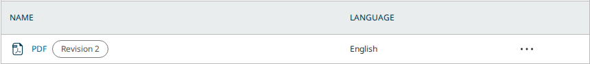

# Galleys from the Body Text (pkp-lib#13543): exporting on a new version rewrites the published version's galleys, and the PRs' own checks are red

- **Severity** high (finding 9); low (the rest)
- **Effort** medium (finding 9); small each (the rest)
- **Kind** PR review before the merge: a regression path into a published version's files, two faults in the PRs' own build and test, an intention gap, a question, a small fault
- **Affects**
  - main: OJS with the PRs (none merged yet); OMP and OPS build and run with the shared PRs and show nothing new
  - 3.5: none (code; the Body Text editor is `main` only)
  - 3.4: none (code)
  - 3.3: none (code)
- **Introduced** `pkp/pkp-lib#13545`, `pkp/ui-library#1021` and `pkp/ojs#5946` for `pkp/pkp-lib#13543` · open PRs, heads
  [945c3e6cb0](https://github.com/pkp/pkp-lib/pull/13545/commits/945c3e6cb06a5a5b6919b708d7da8b40be5ab9fd),
  [210f63608e](https://github.com/pkp/ui-library/pull/1021/commits/210f63608e39168f533414c3782a8a2680e58032) and
  [37dce66451](https://github.com/pkp/ojs/pull/5946/commits/37dce66451f12cab5e46f6d1eccb416652936f84) ·
  2026-10-20 · Vitaliy-1
- **Upstream** `pkp/pkp-lib#13543` (open, milestone 3.6; [the comment listing the three PRs](https://github.com/pkp/pkp-lib/issues/13543#issuecomment-6215019753))
- **Tracked in** ci-triage Companion row `13543` · Temporary: delete once acted on
- **Checked** 2026-10-21, the PR heads and their bases (the commits in Evidence)
- **Model** claude-opus-5-5

Update 2026-10-21: round 2 at the new heads, walked again in full at the
heads and the bases. Of round 1's findings, 1 (a hand-made galley taken
over), 2 (the Word import), 4 (no screen) and 6 (a failed save's file)
are fixed; 3 (the revision badge) and 5 (the placeholder) stand. New:
finding 9 (a new version's export rewrites the published one), findings
7 and 8 (red checks on the PRs) and finding 10 (the Layout Editor).

## Summary

pkp-lib#13543 asks for the Body Text editor's document to become HTML and
PDF galleys without a download and re-upload by hand. With the three PRs
it does. The Body Text page has an "Export" menu with "Export to HTML"
and "Preview: PDF". The first saves the text as an "HTML" galley, its
figures copied beside it. The second opens a page preview whose "Create
PDF" builds the PDF in the browser and saves it as a "PDF" galley. Each
new export adds a revision to the same galley. The galley list marks
these galleys "Generated from text editor" and shows "Revision N" from a
file's second version. Authors are refused. An image from another
submission, or one whose address is not http(s), is refused too.


| # | Finding | Severity | Effort | Round 2 |
|---|---|---|---|---|
| 9 | On a new version, "Export to HTML" and "Create PDF" rewrite the published version's HTML and PDF galleys: its readers get the draft's text | high | medium | new |
| 7 | The PR's own unit test asserts on variables that no longer exist: all six cases fail, so all five OJS PHPUnit and upgrade jobs are red | low | small | new |
| 8 | ui-library's `vite.config.js` imports a file from `../pkp`, which only exists inside an app: ui-library's "run-tests" and Chromatic checks are red | low | small | new |
| 10 | A Layout Editor is refused the export (401), though the same user may add galleys on "Galleys" | low | small | new |
| 3 | ❓ "Revision 2" shows on every galley whose file was changed by hand (U46 S1 red) | low | small | stands |
| 5 | The refusals read "The {$param} parameter contains an invalid value." or "Unable to process API request." without the reason | low | small | stands |
| 1, 2, 4, 6 | A hand-made galley taken over; the Word import broken; no screen; a failed save's file left behind | | | fixed |

From the tests' side the PRs are not ready to merge. Finding 9 changes
what readers of a published version download, with no warning and no
"Change File" pressed. Findings 7 and 8 keep the PRs' own checks red,
and U46 S1 goes red on every OJS PR until question 3 is answered. The
merge is the team's call. Asked of the author: a fix for 9, the one-line
fixes under 7 and 8, an answer to 3, and a decision on 10.

## Impact

- **Lost**: with finding 9, a published version's HTML and PDF galleys
  serve the new draft's text to readers, and the published text is gone
  from screen (it is kept only as a file revision). Findings 7 and 8 turn
  the PRs' checks red, and once merged every later OJS and ui-library
  PR's checks too.
- **Who**: readers and editors of any article that gets a new version
  after its galleys were generated (9); developers reading PR checks
  (7, 8); Layout Editors (10); editors whose export is refused, who are
  not told why (5).
- **Way round**: before exporting on a new version, delete the galleys
  the new version copied, so the export makes fresh ones (9; read in the
  code, not driven).

Severity high for finding 9: published content changes without a warning
and without a way back on screen.

## Finding 9: exporting on a new version rewrites the published version's galleys

### Steps to reproduce

From PKP's default dataset, OJS, with the PRs, as `dbarnes`:

1. Article 17 (published). On its "Body Text", type "version one", then
   "Export" › "Export to HTML", and "Preview: PDF" › "Create PDF". The
   version gets an "HTML" and a "PDF" galley, "Generated from text editor".
2. "Create New Version".
3. On the new version's "Body Text", change the text to "version two",
   then export HTML and create the PDF again.
4. Signed out, open the published version's HTML and PDF galleys.

**Expected**: the published version keeps "version one"; the new
version's export writes its own files.

**Actual**: the published version's HTML and PDF now hold "version two".
A signed-out reader downloads the draft's text from both.

### Cause

"Create New Version" copies each galley with its `submissionFileId` and
`generatedFrom` (OJS `classes/publication/Repository.php`, `clone
$galley`), so both versions' galleys point at the same submission file.
That is the known U46 A4, until now reached only by "Change File" on the
new version. `createGalleyFile()` finds the copied galley by label and
`generatedFrom`, then adds the new content as a revision of that shared
file (`Repo::submissionFile()->edit($submissionFile, ['fileId' => …])`).
New figures are attached to the shared HTML file too. Only the new
galley's HTML cache key is cleared, so signed-out readers of the
published version may see the old HTML for up to a day, then the new
(read in the code; the walk's reader had no cached copy and got the new
text at once).

### Proposed fix

When the galley's submission file is also used by another version's
galley, give this galley a new submission file instead of revising the
shared one (not tried):

```php
$shared = DB::table('publication_galleys')
    ->where('submission_file_id', $galley->getData('submissionFileId'))
    ->where('galley_id', '!=', $galley->getId())
    ->exists();
if ($shared) {
    // add a new proof file as in the "!$galley" branch, then
    // Repo::galley()->edit($galley, ['submissionFileId' => $newSubmissionFileId]);
}
```

- **Alternatives**: copy the files when a version is created (the fix
  U46 A4 needs anyway, which also covers "Change File").
- **What goes with it**: the cache key of every galley that shared the file.

Effort medium: the new-file branch exists already, but the copy of the
figures and a test on two versions go with it.

## Finding 7: the PR's unit test is stale

### Steps to reproduce

1. OJS at pkp/ojs#5946 with pkp-lib#13545 in `lib/pkp`.
2. `lib/pkp/lib/vendor/bin/phpunit -c lib/pkp/tests/phpunit.xml lib/pkp/tests/classes/galley/maps/SchemaTest.php`

**Expected**: 6 tests pass.

**Actual**: 6 fail, each with "Undefined variable $showLabel" and
"Failed asserting that 1 is identical to ''." (and so on for 2 and 3).
All five jobs of the PR's own OJS check are red (pgsql, MySQL and the
three upgrade jobs); the two logs read (pgsql, and pgsql with upgrade)
fail on these six cases.

### Cause

The last pkp-lib commit ("Use revision count instead of the label in the
schema") changed the map from a `revisionLabel` text to a `revisionCount`
number. The test still builds the old expected value:
`$showLabel ? __('galley.revision', ['revision' => $revisionNumber]) : ''`.
Neither variable exists any more.

### Proposed fix

Tried: assert the count.

```php
$this->assertSame($revisions, $output['revisionCount']);
```

With it, 6 of 6 pass at the head. The same test against the base code
fails all 6 (`revisionCount` is missing there), so it does test the change.

Effort small: one line.

## Finding 8: ui-library cannot build on its own

### Steps to reproduce

1. Check out pkp/ui-library#1021 on its own, outside an app.
2. `npm install`, then `npm run test` or `npm run build-storybook`.

**Expected**: the tests run and Storybook builds.

**Actual**: `failed to load config from …/ui-library/vite.config.js`,
`Could not resolve "../pkp/tools/vivliostyleCompat.vite.js"`. The PR's
"run-tests" and "chromatic-deployment" checks fail this way.

### Cause

`vite.config.js` now imports `../pkp/tools/vivliostyleCompat.vite.js`.
That path resolves only when ui-library sits in an app's `lib/` folder
beside `lib/pkp`. ui-library's own CI, Storybook and Chromatic check it
out alone.

### Proposed fix

Keep the plugin inside ui-library, for example `tools/vivliostyleCompat.vite.js`,
and import it from there:

```js
import vivliostyleCompat from './tools/vivliostyleCompat.vite.js';
```

The apps' `vite.config.js` can keep importing pkp-lib's copy, or import
ui-library's (`./lib/ui-library/tools/…`) so only one copy exists.

Tried (`ui-library-fix.diff` in the kit): with the plugin copied to
`tools/` and the import changed, a standalone checkout's `npm run test`
passes (8 files, 80 tests) and `npm run build-storybook` completes. At
the head, both stop at the config error.

Effort small.

## Finding 10: a Layout Editor cannot export

A Layout Editor (`gcox` on article 5, in Production) is refused
`POST …/bodyText` with 401 `api.submissions.403.userCantEdit`, while the
same user may add galleys on "Galleys". The export uses the Body Text's
save permission, which needs "edit metadata": at the base the same user
cannot save the Body Text either. The "Export" menu does not check the
permission, so it is offered and ends in an error (read in the code, not
driven on screen). Whether the user who builds galleys should export them
is the author's call. If yes, allow the two routes for users with
Production access; if not, hide "Export" for users who cannot save.

## Finding 3: ❓ "Revision 2" on a galley changed by hand (U46 S1)

With the PRs, "Change File" on any galley adds "Revision 2" to its name
cell. The badge counts the file's revisions, whatever made them.




The question for the author is unchanged from round 1: is the badge meant
for every galley, or only for those the editor generated? The new unit
test has "manual" cases with counts, which suggests every galley. Either
answer works for the tests:

- **Every galley**: U46 S1 reads a row by its whole name cell, so it
  needs to read the label alone. That is a test change on pkp-e2e's
  side, made once the answer is in. Tried: with `row()` reading the
  label's own `span`, U46 S1 passes at the head.
- **Generated only**: the badge's `v-if` in `GalleyManagerCellName.vue`
  also checks `galley.generatedFrom === 'editor'`, and U46 stays as it is.

Round 1's smaller point is fixed: the badge now first shows on the
file's second version, as "Revision 2". The map still runs a revisions
query per galley wherever galleys are summarised.

## Finding 5: the refusals do not say why

- A PDF body that is not a PDF (400) and an HTML body sent as JSON (415)
  answer "The {$param} parameter contains an invalid value.":
  `api.400.invalidValue` is called without its `param`.
- An export refused for its images (an image of another submission, or
  a `file:` address) answers 422 "Unable to process API request.". The
  controller passes the exception's message as `message`, but
  `api.422.routeRequestUnableToProcess` has no `{$message}`, so the
  editor's error box gives no reason.

Fix (not tried): pass `param`, and use a text that carries the reason.

## Notes, not findings

- **Generating on a published version.** As in round 1, a generated
  galley lands on a published version at once (U46 Rule 10: "Every change
  reaches readers at once"). With finding 1 fixed, a version that already
  has a hand-made "PDF" gets a second "PDF" galley. Its readers then see
  two "PDF" links until an editor removes one.

## Evidence

- **Heads**: ojs `37dce66451f12cab5e46f6d1eccb416652936f84`, lib/pkp
  `945c3e6cb06a5a5b6919b708d7da8b40be5ab9fd`, lib/ui-library
  `210f63608e39168f533414c3782a8a2680e58032`; OMP `5777025be` and OPS
  `f048e747b4` at their tips with both shared heads in their submodules.
- **Bases**: ojs `d270741b6bbe64d9932d9622e86b4631d8506ef1`, lib/pkp
  `45f674d77b537413e1d0604fde20bf5da449fb9a`, lib/ui-library
  `9cfb898731e5afbfa13932f27056c5d1ac2f6fb2`. Since then pkp-lib `main`
  has two more commits (`58c2998847` pkp-lib#13521, `7269eaf6f0`
  pkp-lib#13561), and ojs `main` one (`3109a59114`, a `lib/pkp` bump).
  Both shared PRs merge into their tips cleanly. GitHub shows ojs#5946
  "CONFLICTING", but only on the `lib/pkp` pointer, which a re-bump
  after pkp-lib's merge resolves.
- **Walk**: `shared/playwright/checks/sync/pkp-lib-13545/walk.js` via
  `side.sh base|head`, on dataset fleet 1, freshly reset each side. It
  records absence, so the same script runs on both sides.
  - At the base: every POST answers 500 ("The POST method is not
    supported for route …", "The route …/bodyText/pdf could not be
    found."). The Body Text page has no "Export". After "Change File" the
    cell reads "PDF".
  - At the head, the API: A1–A3 201 (HTML galley 4, then revision 2; PDF
    galley 5). A4 400 and A5 415 with the placeholder text. B2 201 makes
    a new "PDF" galley 7 beside the hand-made galley 6, which keeps its
    file (finding 1 fixed). C1/C2 201 on published publication 18. The
    reader still downloads the hand-made 14,572-byte PDF and sees links
    "PDF", "PDF", "HTML". D1: the author `vkarbasizaed` gets 401
    `user.authorization.roleBasedAccessDenied`.
  - At the head, the screen (submission 6): text typed, "Insert figure"
    `figure.png`, "Save". "Export" offers "Export to HTML" and "Preview:
    PDF". "Export to HTML" answers 201 and shows "HTML galley saved.".
    The file holds `` and one dependent file
    `figure-53-37.png`. A second export gives "Revision 2" and no second
    copy. The editor's view of the HTML galley loads the figure. "Preview:
    PDF" shows the text and the figure. "Create PDF" answers 201 in about
    2 s and shows "PDF galley saved.". The PDF is 25,532 bytes, starts
    `%PDF-1.7` and holds one image. Headless Chromium has no PDF viewer,
    so the in-page viewer was not checked by eye.
  - Images: an `` naming submission 17's file, or `file:///etc/passwd`,
    gets 422. The `files` table holds 40 rows before and after, so nothing
    is left behind. An outside `https://` image is kept (201).
- **Unit test**: as finding 7; logs in `.reports/pr-13543/unit/`.
- **Lockfile**: `npm ls prosemirror-model` at the OJS head shows one copy,
  deduped (finding 2 fixed).
- **Builds**: OJS (`npm ci` from the PR's lockfile), OMP and OPS with the
  shared heads all build. OMP and OPS lack `vivliostyle-pdf` and
  `prosemirror-model`. Only `WorkflowPageOJS.vue` imports the Body Text
  page, so their bundles need neither.
- **The PRs' own checks**: pkp/ojs run 39477689984 (PHPUnit and upgrade
  jobs, finding 7). pkp/ojs run 39477690837 job 1/3: U46 S1,
  `galleys.row('PDF')` not found after "Change File" (finding 3). ui-library
  runs 39477223107 and 39477222854 (finding 8).
- **Suites**: pkp-e2e run [39569037466](https://github.com/jardakotesovec/pkp-e2e/actions/runs/39569037466), OJS at the PR head, OMP and OPS at their tips, pkp-lib and ui-library pinned at the heads in all three: OJS red on U46 S1 alone (finding 3), every other test green in the three apps, U48 included (finding 2 fixed).
- **Finding 9 and 10 walk**: `newversion.js` (in the kit) via the same
  fleet, reset, at the heads and bases. It sends the requests the
  "Export" menu sends (the menu itself is driven in `walk.js`) and
  "Create New Version" through the API. At the heads: on publication 18
  (published) HTML galley 4 and PDF galley 5, files 46 and 47, text
  "version one"; "Create New Version" (publication 22) copies them as
  galleys 7 and 8 with the same files 46 and 47; the exports on 22 answer
  201 and revise files 46 and 47; publication 18's galleys and a
  signed-out download now read "version two". `gcox` 401 on the POST and
  on the save. At the bases every POST answers 500 (no route); the copied
  galley shares file 40 there too (U46 A4).
- **Regression read**: one reader on the heads' code. Its five
  suspicions: finding 9, finding 10, one more in Security below, and two
  left unverified: the native XML export drops `generatedFrom`, so an
  imported article's next export adds a second galley (code read); and
  the MathJax settings the export needs (`linebreaks.inline = false`,
  `fontCache = 'none'`) apply to the whole page, so long inline equations
  in the editor may stop wrapping (code read). Its hunch that a
  `filter_galley_html` journal strips the exported equations' SVG is not
  checked.
- **Security**: one finding routed to pkp-e2e-sec, verified. Authors
  are refused, and an image of another submission is refused before any
  file is written.
