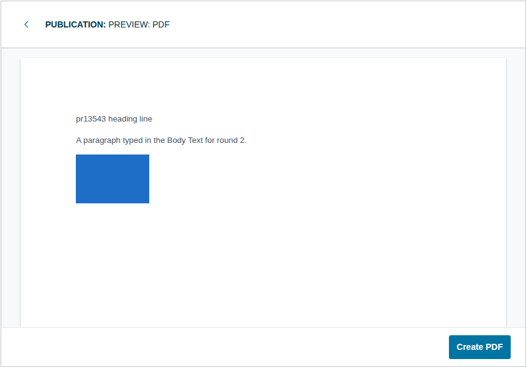
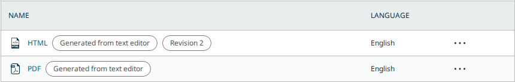

# Galleys from the Body Text (pkp-lib#13543): simultaneous exports make duplicate galleys

- **Severity** low
- **Effort** small
- **Kind** PR review before the merge: a fault the round-3 change brought back
- **Affects**
  - main: OJS with the PRs (none merged yet); OMP and OPS build and run with the shared PRs and show nothing new
  - 3.5: none (code; the Body Text editor is `main` only)
  - 3.4: none (code)
  - 3.3: none (code)
- **Introduced** `pkp/pkp-lib#13545`, `pkp/ui-library#1021` and `pkp/ojs#5946` for `pkp/pkp-lib#13543` · open PRs, heads
  [927200b331](https://github.com/pkp/pkp-lib/pull/13545/commits/927200b33130c201ea5b78b8d6c9e4e15aae0ef5),
  [55e00e3a85](https://github.com/pkp/ui-library/pull/1021/commits/55e00e3a851d33879005470b74fad8885b975076) and
  [4f4cfe83e4](https://github.com/pkp/ojs/pull/5946/commits/4f4cfe83e47001cd6174e76632e45387f539afd0) ·
  2026-10-23 · Vitaliy-1
- **Upstream** `pkp/pkp-lib#13543` (open, milestone 3.6; [the comment listing the three PRs](https://github.com/pkp/pkp-lib/issues/13543#issuecomment-6215019753))
- **Tracked in** ci-triage Companion row `13543` · Temporary: delete once acted on
- **Checked** 2026-10-23, the PR heads and their bases (the commits in Evidence)
- **Model** claude-opus-5-5

Update 2026-10-23: round 3 at the new heads, walked again in full at the
heads and the bases. Every finding open after round 2 is fixed: 9 (a new
version's export rewrote the published one), 7 (the stale unit test), 8
(ui-library's build), 10 (the Layout Editor), 5 (the refusals' reasons),
and question 3 is answered "generated galleys only". New: finding 11, which
the round-3 change caused by dropping a lock.

## Summary

pkp-lib#13543 asks for the Body Text editor's document to become HTML and
PDF galleys without a download and re-upload by hand. With the three PRs
it does. The Body Text page has an "Export" menu with "Export to HTML"
and "Preview: PDF". The first saves the text as an "HTML" galley, its
figures copied beside it. The second opens a page preview whose "Create
PDF" builds the PDF in the browser and saves it as a "PDF" galley. Each
new export adds a revision to the same galley. On a new version, the
export gives the copied galley a file of its own, so the published
version keeps its text. The galley list marks these galleys "Generated
from text editor", and shows "Revision N" on them from the file's second
version. Authors are refused. An image from another submission, or one
whose address is not http(s), is refused with a reason.





| # | Finding | Severity | Effort | Round 3 |
|---|---|---|---|---|
| 11 | Simultaneous exports of one version each make a galley: four at once left 2 or 3 "HTML" galleys and 2 or 3 "PDF" galleys | low | small | new |
| 9 | On a new version, the export rewrote the published version's HTML and PDF galleys | | | fixed |
| 7 | The PR's own unit test asserted on variables that no longer existed | | | fixed |
| 8 | ui-library's `vite.config.js` imported a file from `../pkp` | | | fixed |
| 10 | A Layout Editor was refused the export | | | fixed |
| 3 | ❓ "Revision 2" on every galley whose file was changed by hand (U46 S1 red) | | | answered: generated galleys only |
| 5 | The refusals did not say why | | | fixed |
| 1, 2, 4, 6 | A hand-made galley taken over; the Word import broken; no screen; a failed save's file left behind | | | fixed in round 2 |

From the tests' side two points remain before the merge: finding 11
here, and one security point routed privately to the team. Finding 11
needs two exports of the same version at the same moment, by two people
or by a request sent twice. Its fix is the line round 2 had (tried). The
merge is the team's call.

## Impact

- **Lost**: nothing is lost. A version gets a second (or third) "HTML" or
  "PDF" galley. Once published, readers see the label twice until an
  editor deletes the extra one. Later exports revise only one of them, so
  the other keeps the older text.
- **Who**: editors and Layout Editors who export the same version at the
  same time, or whose export request is sent twice.
- **Way round**: delete the extra galley on "Galleys".

Severity low: it needs simultaneous requests, it is visible on
"Galleys", and one deletion clears it.

## Finding 11: simultaneous exports make duplicate galleys

### Steps to reproduce

From PKP's default dataset, OJS with the PRs, served by more than one PHP
worker (as php-fpm serves a site), as `dbarnes`:

1. Submission 15 (Production, no galleys). Send four `POST
   …/submissions/15/publications/16/bodyText` (HTML) at the same moment.
2. Submission 5 (Production, no galleys). Send four `POST
   …/submissions/5/publications/6/bodyText/pdf` at the same moment.
3. Open "Galleys" on each.

**Expected**: one "HTML" galley on 15 and one "PDF" galley on 5, with the
later exports as revisions of them.

**Actual**: all eight requests answer 201. Submission 15 has two or three
"HTML" galleys, and 5 has two or three "PDF" galleys, each with its own
file (three runs, each on a fresh dataset).

### Cause

Round 3 removed the first statement in `createGalleyFile()`'s transaction
(`classes/bodyText/Repository.php`, head `927200b331`):

```php
// Serialize concurrent exports so they cannot create duplicate galleys.
DB::table('publications')->where('publication_id', $publicationId)->lockForUpdate()->first();
```

Without it, each request looks for the version's generated galley, finds
none, and adds one. By the code, the same race on a new version's copied
galley adds more than one new file and attaches only the last to it,
leaving the others unused (not driven).

### Proposed fix

Tried: put the two lines back at the top of the transaction
(`lock-fix.diff` in the kit). On the head with the fix, four simultaneous
HTML exports and four simultaneous PDF exports each leave one galley.
Every request answers 201, and the later ones are revisions (twice, each on
a fresh dataset).

- **Alternatives**: none needed; the lock costs one row lock per export.

Effort small: two lines.

## Fixed since round 2

- **Finding 9** (high in round 2). When the copied galley's file is used
  by another galley, the export now adds a new submission file
  (`isShared`). Driven: on article 17, after "Create New Version", v2's
  exports wrote files 48 and 49. Version 1 keeps files 46 and 47, one
  revision each, and a signed-out reader still downloads "version one"
  from both. With a figure, v3's export got file 52 and its own figure
  copy 53. v2 kept file 48 and its figure 49, which loads for a
  signed-out reader. (Verified at round 3's head `927200b331`.)
- **Finding 7**. The test asserts the count: `SchemaTest` 6 of 6 pass at
  the head.
- **Finding 8**. The Vivliostyle build workaround is gone from ui-library,
  pkp-lib and OJS. ui-library's "run-tests" and "chromatic-deployment"
  checks are green at `55e00e3a85`. "Create PDF" still works in the OJS
  build at the head (201 in 2 s, a 25,532-byte `%PDF-1.7` with one image).
- **Finding 10**. `gcox` (Layout Editor, no "edit metadata") now gets
  201 on HTML and PDF. Saving the Body Text itself stays refused to him (401), as at
  the base.
- **Question 3**. The badge now needs `generatedFrom === 'editor'` (the
  second answer offered in round 2). After "Change File" on a hand-made
  galley the cell reads "PDF" at the head, as at the base, so U46 S1 needs
  no change. A generated galley still shows "Revision 2" from its second
  export.
- **Finding 5**. The refusals now name the parameter ("The body parameter
  contains an invalid value.", "The Content-Type parameter …"), and the
  image refusals give the reason ("The HTML references an image that is
  not attached to this publication's body text.", "… that cannot be
  exported."). Any other failure is logged and answers 500.

## Notes, not findings

- **Generating on a published version.** As in rounds 1 and 2, a
  generated galley lands on a published version at once (U46 Rule 10:
  "Every change reaches readers at once"). A version that already has a
  hand-made "PDF" gets a second "PDF" galley. Its readers then see two
  "PDF" links until an editor removes one.

- **Export without Save.** A Layout Editor without "edit metadata" may
  now export (finding 10), but "Save" on the same Body Text page still
  answers 401 for him (driven: `gcox` on 5, export 201, save 401). His
  export can therefore carry text the Body Text never stored, and the
  next editor who opens the page sees the older text. Whether "Save"
  should follow is the author's call.

## Evidence

- **Heads**: ojs `4f4cfe83e47001cd6174e76632e45387f539afd0`, lib/pkp
  `927200b33130c201ea5b78b8d6c9e4e15aae0ef5`, lib/ui-library
  `55e00e3a851d33879005470b74fad8885b975076`; OMP and OPS at their tips
  with both shared heads in their submodules (CI).
- **Bases**: ojs `3cf9aa91a8e357f5d95ad9f9bbcad7e7b29424ef` (the OJS tip),
  lib/pkp `00ce12be776175920847e3da4910617c47af290c` (pkp-lib `main`),
  lib/ui-library `e47a48879a2bc93fda82d7544f8c22a6cc3e2908` (ui-library
  `main`). All three PRs were rebased onto their tips.
- **Changes since round 2** (`git range-diff`): pkp-lib's first two commits
  and ui-library's first two are unchanged (`=`). pkp-lib's third commit
  was rewritten: the export routes' access check (now the Production
  stage, as the Galleys page), `ConversionException`
  and the reasons, the `isShared` branch with
  `Collector::filterBySubmissionFileIds()`, the test, the lock removed, and
  `tools/vivliostyleCompat.vite.js` deleted. ui-library and OJS each add
  one commit, the badge's `generatedFrom` check and the build workaround's
  removal.
- **Walks**: `side.sh base|head` in the kit runs `walk.js`,
  `newversion.js`, `figure.js` (new) and `race.js` (new) on dataset fleet
  1, reset before each walk.
  - At the base: every POST answers 500 ("The POST method is not supported
    for route …", "The route …/bodyText/pdf could not be found."). The
    Body Text page has no "Export". Nothing is stored.
  - At the head, `walk.js`: A1–A3 201 (HTML galley 4, then revision 2;
    PDF galley 5). A4 400 "The body parameter …", A5 415 "The Content-Type
    parameter …". B: after "Change File" the hand-made galley reads "PDF";
    B2 adds a generated "PDF" beside it. C1/C2 201 on published
    publication 18. D1 the author `vkarbasizaed` 401
    `user.authorization.roleBasedAccessDenied`. E: the screen as in round
    2 (the figure copied once, "Create PDF" 201 in 2 s). F1/F2 422 with the
    reasons, `files` 40 rows before and after; F4 an outside https image
    kept (201).
  - At the head, `newversion.js` and `figure.js`: finding 9 fixed, as
    above.
  - `race.js` starts a second `php -S` with `PHP_CLI_SERVER_WORKERS=4` on
    the same install and sends four requests at once. At the head
    (three runs): HTML galleys 4, 5 / 4, 5, 6 / 4, 5, 6; PDF galleys 6, 7, 8 /
    7, 8 / 7, 8. With `lock-fix.diff` applied (`bin/try-fix.js`, two runs):
    one galley each. At the base: 500, nothing stored.
- **Unit test**: `SchemaTest` at the head, 6 tests, 18 assertions, pass.
- **The PRs' own checks**: ui-library `run-tests` and
  `chromatic-deployment` green at `55e00e3a85`. pkp/ojs run [39948900520](https://github.com/pkp/ojs/actions/runs/39948900520) at `4f4cfe83e4`: validate, both PHP 8.3 jobs (pgsql, MySQL) and the pgsql and MariaDB upgrade jobs green, PHPUnit included; the MySQL upgrade job red on OJS's own Cypress `publicComments/PublicComments.cy.js` alone (19 of 24): its first test never got the login form (`input[id=username]`), and the rest depend on the comments that test creates. The same spec passes 24/24 in the MariaDB job at the same head, the PR touches neither sign-in nor comments, and the workflow is green on `main` at the base (`3cf9aa91a8`, run 39820598877): read as a one-off, not the PR's (not rerun: the bot cannot rerun pkp/ojs jobs). pkp/ojs e2e run 39948901270: 3/3 green.
- **Regression read**: one reader on round 3's changes, read only.
  Three suspicions: finding 11 (reproduced, above); the PDF in the built
  bundle after the workaround's removal (not reproduced: "Create PDF"
  works in the head's `npm run build`); one routed (Security below). Two
  hunches: an export on a version whose galley file lacks the journal's
  current primary locale may answer 500 (not checked), and the Layout
  Editor's export without "Save" (driven, the note above).
- **Suites**: pkp-e2e run [39949633607](https://github.com/jardakotesovec/pkp-e2e/actions/runs/39949633607), OJS at the PR head, OMP and OPS at their tips, pkp-lib and ui-library pinned at the heads in all three. All 9 jobs green, U46 and U48 included.
- **Security**: one finding routed (round 2), still open at round 3's
  head (verified live); the detail is with the team privately. Authors
  are refused, and an image of another submission is refused before any
  file is written.
