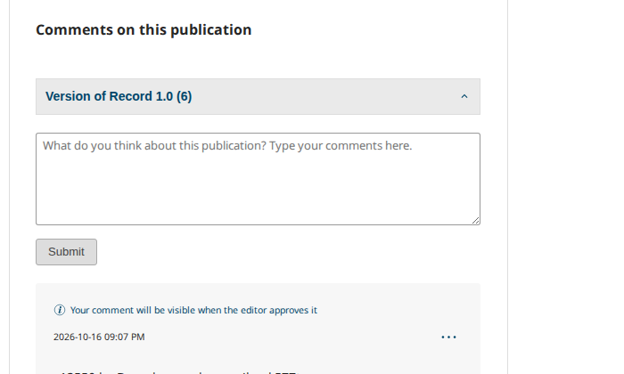
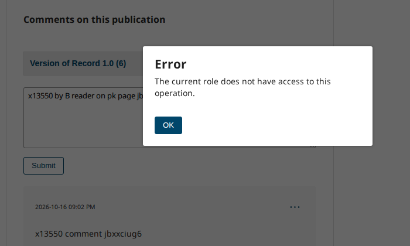
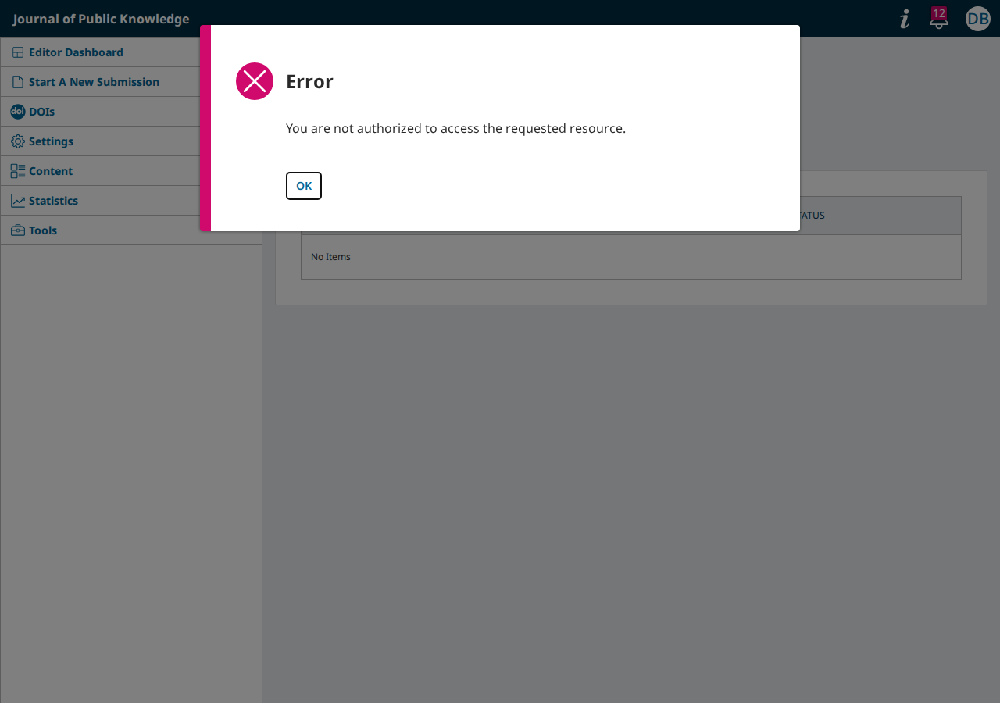

# PR review of pkp/pkp-lib#13550, the comments API checks: the fixes hold; a cross-journal comment answers a server error, a reader of another journal is offered controls the server refuses, and the Comments page errors with comments off

- **Severity** low
- **Effort** small
- **Kind** defect (findings 1 and 3); intention gap (finding 2), all in the PR before its merge
- **Crash** server (finding 1)
- **Affects**
  - main: OJS, OMP, OPS with the PR (finding 2: OJS, the only app with a comment box)
  - 3.5: none (no reader comments)
  - 3.4: none (code; no reader comments)
  - 3.3: none (code; no reader comments)
- **Introduced** `pkp/pkp-lib#13550` and `pkp/ojs#5949` for `pkp/pkp-lib#13539` · open PRs, heads
  [08024165dd](https://github.com/pkp/pkp-lib/pull/13550/commits/08024165dba9d2f6c824ad2b536355ab65e7ac01)
  (on `6ff76591a9`, the `main` tip) and
  [e212f37863](https://github.com/pkp/ojs/pull/5949/commits/e212f3786388c59c21190040ab9fdfbdd2cb7511)
  (a pointer bump on `f3c0f72f89`, the OJS tip) · 2026-10-16 · Taslan A. Graham (taslangraham)
- **Upstream** `pkp/pkp-lib#13539` (open; it lists the two PRs)
- **Tracked in** spec U14 [A20](https://github.com/jardakotesovec/pkp-e2e/blob/i13539-main/docs/specs/U14-reader-comments-and-moderation.md#a20), [A21](https://github.com/jardakotesovec/pkp-e2e/blob/i13539-main/docs/specs/U14-reader-comments-and-moderation.md#a21) (on the companion `i13539-main`) · ci-triage Companion row · Temporary: delete once acted on
- **Checked** 2026-10-16, the PR heads and their base (the commits in Evidence)
- **Model** claude-opus-5-5

## Summary

pkp/pkp-lib#13539 asks for three things: no comment on a publication that
is not published or belongs to another journal, reports read by
moderators only, and no comment action in a journal where the account has
no role. The PRs do all three. Walked on PKP's default dataset at the PR
heads and at their base:

| Check | Base `6ff76591a9` | Head `08024165dd` |
|---|---|---|
| U14 A17: `comments/public?…&includeReports=1`, signed out and as the comment's writer | the reporter's name, affiliation and reason | no `reports`; the Journal editor still gets them |
| U14 A18: a comment by request on an unpublished version, with comments off, by an anonymous reviewer (OJS, OMP, OPS) | `200`, kept, the answer names title and author | refused (`401` with comments off, `422` with them on), nothing kept |
| A comment on the published version with comments on (the box on OJS, the request on the three apps) | `200` | `200` |
| U14 A12: another journal's manager reading, approving, deleting the reports of publicknowledge's comment; that journal's Reader reporting it | carried out | `404`, untouched |
| U14 A19: delete all of a comment's reports | `500` unless exactly one | deleted |
| An account with no role in publicknowledge commenting and reporting there | accepted | refused (finding 2) |
| A comment by request in journal B on publicknowledge's published article | `200`, filed under B | `500` (finding 1) |
| Comments switched off: the Comments page by address | lists the comments | an "Error" dialog on every load and tab, "No Items" (finding 3) |

Three findings. None reopens what the issue closes: in each, the
request is refused and nothing is kept.

| # | Finding | Severity |
|---|---|---|
| 1 | A comment request naming another journal's published article answers `500` instead of a refusal | low |
| 2 | An account holding no role in the journal is offered the comment box and "Report"; "Submit" shows an "Error" dialog, "Report" closes without a word | low |
| 3 | With comments switched off, the Comments page still opens, with an "Error" dialog on its load and on each tab and "No Items" in place of the kept comments | low |


The three apps' suites at the PR heads are green (CI 38972630387 on the companion rebased onto `main`, all 9 jobs) with the companion's S1 change, which finding 3 needs.

## Finding 1: a cross-journal comment request answers a server error

A signed-in account with a role in journal B sends the article page's
own request in B, `POST /index.php/<B>/api/v1/comments`, with
`publicationId` 18, publicknowledge's published article. The answer is
`500`:

```json
{"error":"Call to a member function getCurrentPublication() on null"}
```

Nothing is kept and no task is raised. Expected `422` with "The
requested resource was not found.", as for a publication that does not
exist. At the base the same request answered `200` and the comment was
filed under journal B.

**Cause.** `AddComment::after()` now looks the submission up within the
request's journal and adds an error when it is not there, but does not
return, so the next condition calls `getCurrentPublication()` on `null`
([AddComment.php at the head](https://github.com/pkp/pkp-lib/blob/08024165dba9d2f6c824ad2b536355ab65e7ac01/api/v1/comments/formRequests/AddComment.php#L65-L69)):

```php
if (!$submission) {
    $validator->errors()->add('publicationId', __('api.404.resourceNotFound'));
}

if ($submission->getCurrentPublication()->getId() !== $publicationId || …
```

**Proposed fix** (tried:
[fix.diff](https://github.com/jardakotesovec/pkp-e2e/blob/i13539-main/shared/playwright/checks/sync/pkp-lib-13550/fix.diff)):
`return;` after the not-found error. With it both requests (journal B's
manager and its Reader) answer `422` `{"publicationId":["The requested
resource was not found."]}` and nothing is kept.

## Finding 2: a reader of another journal is offered what the server refuses

On a site with two journals, a person registered with journal B (Reader
there, no role in publicknowledge) opens publicknowledge's article 17,
types a comment and presses "Submit". The comment box is offered as to
anyone signed in. With the PR an "Error" dialog reads "The current role
does not have access to this operation." and the text stays in the box.
"Report" on an approved comment fails silently: the window closes as a
filed report's would (U14 A14). Before the PR both were accepted.

At the base:



With the PR:



**Cause.** The PR puts `submit`, `delete` and `submitReport` behind
`roleAuthorizer(Role::getAllRoles())` and `ContextAccessPolicy`, so an
account with no role in the request's journal gets `401`
`user.authorization.roleBasedAccessDenied`. The landing page's comment
component (ui-library `usePkpCommentsStore.js`) offers the box and
"Report" to every signed-in user.

**Question for the team.** The refusal is what the issue asks
("Cross-context access"), so the page should follow it: offer the box and
"Report" only to an account with a role in the journal, and tell anyone
else why (or offer to join the journal as a Reader, as registration
does). If instead any account of the site should comment, the role check
is too wide. Not tried.

## Finding 3: the Comments page with comments off raises an error on every tab

With "Enable Public Comments" unticked, Content › Comments leaves the
side menu, but the page still opens by its address (and, by the code,
from a moderator's task about a comment; not walked). The PR refuses
every comments route while the setting is off
(`UserCommentController::authorize()`: "All /comments endpoints should
be inaccessible if comments are disabled"). So the page's load, and
each tab after it, raises an "Error" dialog, "You are not authorized to
access the requested resource.", and after "OK" the tab reads "No Items",
while the comments are kept. At the base the page listed them and every
action worked.



**Question for the team** (U14 A4, open since 2026-09-16). If the page is
not meant to work with comments off, it should say so (or refuse the
page, as the menu does) instead of an error per tab. If moderators are
meant to clear the kept comments meanwhile, the moderator routes should
stay open while the public ones close. The suite's S1 in the three apps
now asserts the dialog and "No Items" (the companion), so a change here
shows up there. Not tried.

## Evidence

- Walks, OJS on PKP's default dataset (OMP and OPS for A18), each side
  on a freshly loaded dataset: the issue walks under
  `shared/playwright/checks/issues/` (`comment-request-unpublished-submission`,
  `public-comment-list-exposes-reports`, `delete-all-comment-reports-fails`)
  and the kept `shared/playwright/checks/sync/pkp-lib-13550/walk.js` (a
  second journal, the account without a role, the public list's
  refusals, comments off). Head: pkp-lib `08024165dd`, ojs `e212f37863`,
  omp `9f4393633` and ops `1bfe77fcd8` with the head in `lib/pkp`. Base:
  the same apps with pkp-lib `6ff76591a9`. VM slot s1, PostgreSQL.
- The public list at the head: an unpublished publication id, alone or
  beside a published one, answers `404` (at the base `200` with nothing
  of it). The landing page asks for published versions only. The
  site-level address `index/api/v1/comments/public` answers `401` (base
  `404`).
- CI with `pkp_lib_ref` `pull/13550/head`, ojs at the PR head, OMP and
  OPS at their tips, on the companion `i13539-main`:
  [38966936323](https://github.com/jardakotesovec/pkp-e2e/actions/runs/38966936323)
  red on U14 S1 alone in the three apps (the dialog of finding 3 over the
  Comments page's tabs); after the S1 change
  [38970041540](https://github.com/jardakotesovec/pkp-e2e/actions/runs/38970041540),
  all 9 jobs green; rebased onto `main` `78a9496c`,
  [38972630387](https://github.com/jardakotesovec/pkp-e2e/actions/runs/38972630387),
  all 9 jobs green.
- Not read: MySQL and MariaDB (the walks ran on PostgreSQL only); the
  PR's own unit tests (it adds none).
