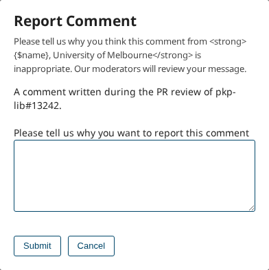

# PR review: pkp/pkp-lib#13242, Theme - Add a new theme using Blade templates (Eidos)

- **Reviewed** round 2, 2026-11-24: [pkp/pkp-lib#13260](https://github.com/pkp/pkp-lib/pull/13260) at `32bbad3aa8`, [pkp/ui-library#972](https://github.com/pkp/ui-library/pull/972) at `68a8b1cd09`, [pkp/ojs#5784](https://github.com/pkp/ojs/pull/5784) at `f87424342c`, [pkp/omp#2594](https://github.com/pkp/omp/pull/2594) at `7cd22d174d`, [pkp/ops#1526](https://github.com/pkp/ops/pull/1526) at `5ea4e4a133`, [pkp/crossref-ojs#107](https://github.com/pkp/crossref-ojs/pull/107) at `d94df909a4` (NateWr, branch `eidos`, each on its `main`'s tip)
- **Scope** this round: the regressions of round 1 (what the PRs change for installs that never switch to Eidos). The Eidos bugs and the gap analysis of 2026-10-14 (`2026-10-14-eidos-theme-bugs.md`, `2026-10-14-eidos-theme-gap-analysis.md`) are handled separately.
- **Model** claude-opus-5-5

## Round 1's fourteen items

Every one is fixed at these heads. How each was checked:

| # | Round 1 item | Fixed by | Checked |
|---|---|---|---|
| 1 | OMP and OPS 500 on every page | omp#2594, ops#1526 add `classes/view/{Homepage,Metadata}BlocksRegistry.php` | OMP and OPS suites on CI (Tests) |
| 2 | The web installer's fatal error | `'site' => Application::isInstalled() ? … : null` | the PR's own Cypress jobs install (run 45405255675) |
| 3 | OJS site home 500 on PostgreSQL | `Application::SITE_CONTEXT_ID_ALL` in both loaders | walk: 200, both journals listed; U20 S4 green |
| 4 | Access-denied page shows a key | `__($authorizationMessage)` | walk: "The current role does not have access to this operation." |
| 5 | Message pages without heading or tab title | `system-message.tpl` prints `$title`, assigns `pageTitleTranslated` | walk: "Register", "Reset Password" headings and tabs; U02 S5, S7, U21 S9, S12, U52 S3 green |
| 6 | `loginMessage` printed as HTML | a key again, checked and translated in `LoginHandler` | walk: the key shows its sentence, free text shows nothing |
| 7 | Author response window empty | `response` per language again, `localizedResponse` beside it | U30 S1 to S8 green |
| 8 | Dead "JATS XML" button | `{if $jatsDownloadUrl}` | walk: article 1 shows "PDF" alone; U46 S3, U48 S4, S5 green |
| 9 | Default theme's comments lose box and layout | the original components restored beside the new ones | walk: the sidebar box and the layout are back (what is still wrong there is items 15 and 16) |
| 10 | Categories on every Default home page | the block assigns `homepageCategories` | walk: the home page starts with "Current Issue"; U10 S9 green |
| 11 | Unbuilt Eidos locks Website Settings | Eidos is an npm workspace that the app's `npm run build` builds | `npm ci && npm run build` builds `plugins/themes/eidos/dist/` |
| 12 | OMP's payment message page blank | OMP's manual and PayPal plugins call `displaySystemMessage()` | OMP suite on CI (U69 S4) |
| 13 | Home page 500 with announcements off and a number stored | the templates test `!empty($announcements)` | walk: 200 with announcements off and the number 2 (but see item 17) |
| 14 | OMP and OPS "Not Allowed" heading a key | `__('submission.wizard.notAllowed')` in both | OMP U21 S9 on CI |

## 15. Default theme: "Report" on a comment opens an empty dialog, so no comment can be reported (medium)

**Steps** (OJS, PKP's default dataset, public comments on, one approved comment on article 1)

1. Sign in as `rvaca`, open article 1, press the comment's "…" and "Report".
   Expected: the sentence "Report the following comment by Daniel Barnes (University of Melbourne)", the comment and a reason box.
   Observed: the title "Report Comment" with "Submit" and "Cancel" only. "Submit" does nothing (the store returns while the reason is empty).


**Cause** `lib/pkp/js/load_frontend.js`: the restored store opens the dialog with `bodyComponent: 'PkpCommentReportDialog'` (ui-library `src/frontend/components/PkpComments/usePkpCommentsStore.js:278`), but pkp-lib#13260 no longer registers that component; `main` does (`load_frontend.js:42`, `:102`). The restore commit `f04e1c5701` put back its two parts (`PkpCommentReportDialogAuthor`, `PkpCommentReportDialogReasonInput`), not the dialog.

**Fix** Register it again; tried (`shared/playwright/checks/sync/pkp-lib-13260/fix-r2-report-dialog.diff`): the sentence, the comment and the reason box are back. U14 S9 and S11 then pass the dialog and stop on item 16's texts.

```diff
+import PkpCommentReportDialog from '@/frontend/components/PkpComments/PkpCommentReportDialog.vue';
 …
+VueRegistry.registerComponent('PkpCommentReportDialog', PkpCommentReportDialog);
```

## 16. Default theme: the original comments get the texts written for Eidos, one with an unfilled `{$name}` (low)

**Steps** (as item 15, with item 15's fix in place for step 1)

1. Open "Report" on a comment. Observed: "Please tell us why you think this comment from <strong>{$name}, University of Melbourne</strong> is inappropriate. …", the tags and the placeholder printed as text.
2. As the comment's writer (`dbarnes`), press "…". Observed: "Delete comment" (was "Delete Comment"); its dialog asks "Are you sure you want to delete your comment?" without quoting the comment as before.
3. A pending comment, the sign-in button and the "show more" button read "Your comment will be visible to everyone once a moderator approves it.", "Sign in to leave a comment" and "Show 1 more comments" (were "… when the editor approves it", "Log in to comment", "Show more (1)").



**Cause** `lib/pkp/locale/en/UserComment.po`:

- `87170ace76` (pkp-lib#13327) rewords keys that both the original and the new components read: `awaitingApprovalNotice`, `login`, `showMore`, `reportCommentBy` and `reportCommentByUserWithAffiliation`. The last two now take `{$name}` and markup; the original `PkpCommentReportDialogAuthor.vue` passes `userName` and prints the text with `{{ }}`.
- `f04e1c5701` adds `deleteComment`, `deleteCommentConfirmation` and `reportComment` again, so each is defined twice in the file. The loader keeps the later definition, so the original gets "Delete comment" and the short confirmation, and Eidos gets "Report Comment" instead of its "Report inappropriate comment".

**Fix** Give the new components keys of their own (or the original its old keys back) and keep one definition per key; `showMore` needs a plural form whichever theme keeps it. Not tried. Which wording the Default theme should show is question A.

## 17. A journal with announcements on and none posted shows an empty "Announcements" block on its home page (low)

**Steps** (OJS, PKP's default dataset, journal "second", no announcement)

1. Switch announcements on with 2 on the home page, then open the journal's home page.
   Expected: no announcements block, as on `main`. Observed: the heading "Announcements" with nothing under it, and a "Skip to announcements" link in the skip links.

**Cause** Round 1's item 13 fix, `424acd6b19`: `lib/pkp/templates/frontend/objects/announcements_list.tpl:14` and each app's `templates/frontend/components/skipLinks.tpl` test `!empty($announcements)`, and an empty Eloquent collection is an object, never empty.

**Fix** Test the count after the null check; tried (`fix-r2-announcements.diff`): no block and no skip link with none posted, item 13's page still 200 with announcements off.

```diff
-{if $numAnnouncements && !empty($announcements)}
+{if $numAnnouncements && $announcements && $announcements|@count}
```

The same line in OMP's and OPS's `skipLinks.tpl`. The test that shows it is "switch announcements on" (U12 S1).

## Questions for the author

- **A. The comments' wording on the Default theme.** With the original components kept for the Default theme, should they keep their old texts ("Log in to comment", "Show more (1)", "… when the editor approves it", "Report the following comment by …", "Delete Comment") or take the new ones? The review leans to the old texts on the original components, as round 1's answer said the original stays as it was beside Eidos's own; with the new ones the suite follows (U14 S2, S7, S8, S9, S10, S11, S12, S16).
- **B. The masthead's history link** now reads "View the full editorial history." (U03 S6, U07 S1, S7, S9, S13, U10 S5 in OJS, the same in OMP and OPS). Intended? Open from round 1.
- **C. The category image** is stored up to 1024 px wide instead of 100 when the journal sets no thumbnail size (U16 S1 in OJS and OPS). Intended? Open from round 1.

## Evidence

- **Checkouts.** OJS, OMP, OPS at the heads above, each with lib/pkp `32bbad3aa8`, lib/ui-library `68a8b1cd09`; OJS's crossref at `d94df909a4`; PostgreSQL, PHP 8.3; built with `npm ci && npm run build` (Eidos built by the OJS root build).
- **The PR's own check.** pkp/ojs e2e 45405256463 at `f87424342c`: 16 red OJS tests, all of them items 15 to 17 or questions A to C (comments 8, history sentence 6, U12 S1, U16 S1). ojs-main 45405255675: every job installs; only `publicComments/PublicComments.cy.js` is red (18 of 24), on the same texts and dialog.
- **CI at the heads.** [45415372255](https://github.com/jardakotesovec/pkp-e2e/actions/runs/45415372255): OJS 16 red, OMP 6, OPS 8, each item 17 (U12 S1 in all three apps) or question A (U14 ×8, OJS), B (U03 S6, U07 S1, S7, S9, S13, OPS U07 S12, U10 S5) or C (U16 S1, OJS and OPS); OPS's serial U12 S4 flaky (a known mail-order flake, green on retry). OMP and OPS render every page; OMP U69 S4 (payment message) and U21 S9 ("Not Allowed") green.
- **Walks** (`shared/playwright/checks/sync/pkp-lib-13260/`, default dataset fleet): `shots.js` (`SIDE=r2`), `default-theme.js` (`PHASES=default,comments,eidos`: Eidos enabled and selected renders its home, article, login and search pages), `announcements-off.js` (`STATE=r2`, `r2-fixed`), new `comments-dialogs.js` and `announcements-empty.js`.
- **Local run with the two tried fixes** (`fix-r2-report-dialog.diff`, `fix-r2-announcements.diff`), U12 and U14 on a reset install: 14 passed, 8 failed. U12 green (S1 included). The eight U14 reds (S2, S7, S8, S9, S10, S11, S12, S16) each stop on a text of item 16 (the approval notice, "Log in to comment", "Show more (1)", "Report the following comment by …", "Delete Comment"), none on the dialog.
- **Not driven.** OMP's and OPS's pages by hand (their suites ran on CI); MySQL and MariaDB.
