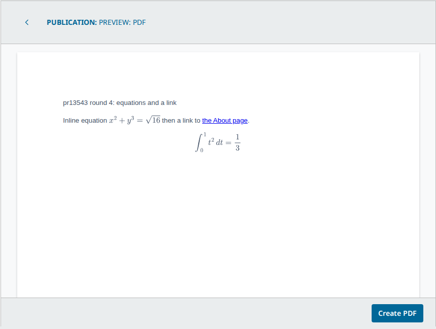
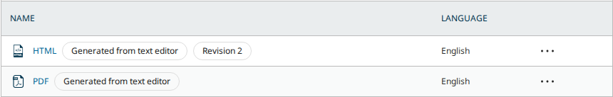
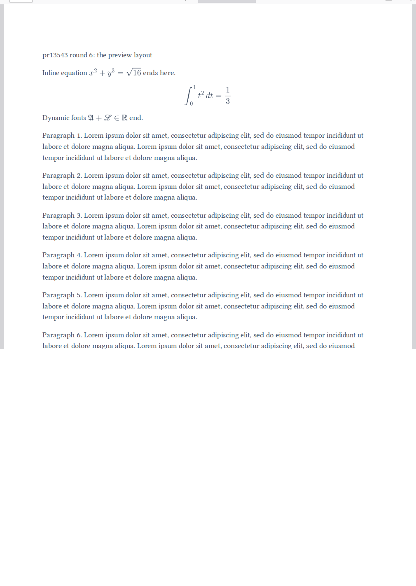
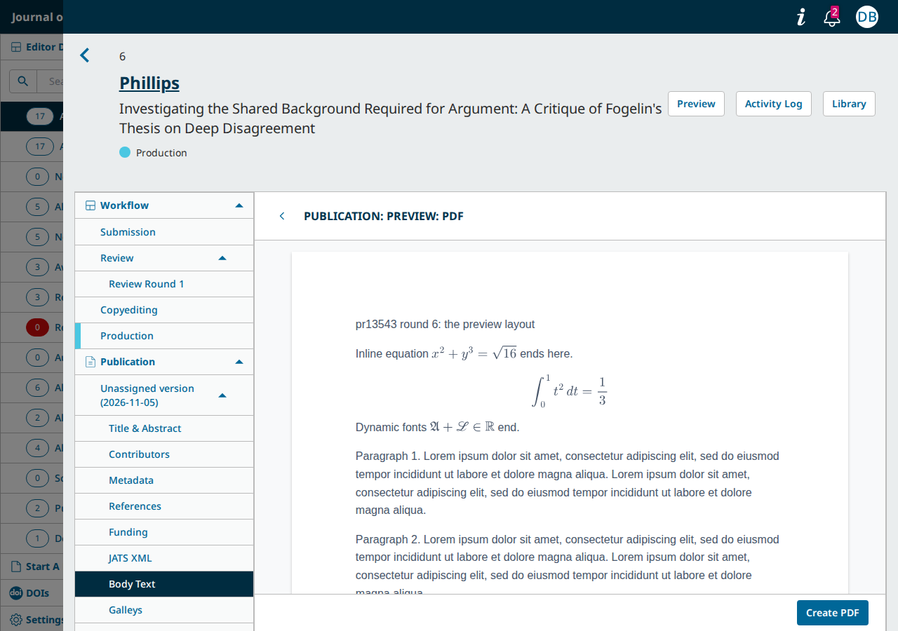

# Galleys from the Body Text (pkp-lib#13543): simultaneous exports make duplicate galleys

- **Severity** low
- **Effort** small
- **Kind** PR review before the merge: a fault the round-3 change brought back, still open at round 6
- **Affects**
  - main: OJS with the PRs (none merged yet); OMP and OPS build and run with their own PRs and the shared PRs, and show nothing new
  - 3.5: none (code; the Body Text editor is `main` only)
  - 3.4: none (code)
  - 3.3: none (code)
- **Introduced** `pkp/pkp-lib#13545`, `pkp/ui-library#1021` and `pkp/ojs#5946` for `pkp/pkp-lib#13543` · open PRs, round 3's heads
  (2026-10-23, Vitaliy-1); still in round 5's heads
  [2222768ff7](https://github.com/pkp/pkp-lib/pull/13545/commits/2222768ff77c8ecc0119ab9825e6632d2701aa92),
  [6338cf1ded](https://github.com/pkp/ui-library/pull/1021/commits/6338cf1ded19220ee3f4c94b81eb88928b853dea) and
  [988f0a5163](https://github.com/pkp/ojs/pull/5946/commits/988f0a516329bf2984a046eee650c7a9cca47268) ·
  2026-11-03 · Vitaliy-1; still in round 6's heads
  [6035a6fed8](https://github.com/pkp/pkp-lib/pull/13545/commits/6035a6fed866eabc4fb297ea653a83b31035d896),
  [e5952751](https://github.com/pkp/ui-library/pull/1021/commits/e5952751241d04b421d5de393a57a9f5e5893c39) and
  [969433cad9](https://github.com/pkp/ojs/pull/5946/commits/969433cad94eba2264fc6cd84907aca257961ba8) ·
  2026-11-07 · Vitaliy-1
- **Upstream** `pkp/pkp-lib#13543` (open, milestone 3.6; [the comment listing the PRs](https://github.com/pkp/pkp-lib/issues/13543#issuecomment-6215019753), now with `pkp/omp#2544` and `pkp/ops#1479`)
- **Tracked in** ci-triage Companion row `13543` · Temporary: delete once acted on
- **Checked** 2026-11-07, round 6's PR heads, with round 5's heads as the control (the commits in Evidence)
- **Model** claude-opus-5-5

Update 2026-11-07: round 6. pkp-lib and OJS are only rebased onto their
tips (`git range-diff` all `=`). ui-library is rebased onto pkp-lib#13714
(MathJax's fonts self-hosted), with the MathJax setup merged by hand, and
adds one commit: the PDF preview fills the panel. OMP and OPS now carry
only the vite and `dompurify` updates (OPS also adds the two galley schema
properties), so the MathJax and Vivliostyle copies are gone from their
builds. Every walk gives round 5's results. The new layout works, the
equations are drawn in the preview and the PDF with third-party hosts
blocked, and nothing new was found. Still open, unchanged: finding 11,
the HTML export with no journal in the request, and the security point
routed privately. CI at the heads: 8 of 9 jobs green, the ninth red on an
OPS password test the PR does not reach (a flake: green alone at the same
head and in pkp/ops's own check).

Update 2026-11-03: round 5. pkp-lib adds one commit (the user may be
missing, for a call from the command line), OJS documents the two routes
in its API docs, and OMP and OPS have PRs of their own (their
dependencies and build). The earlier commits are unchanged. Of round 4's
open reviewer comments: the API docs are resolved, and the OMP/OPS
question is answered by the two new PRs. The call without a user is still
only partly resolved: the PDF export now works with no user and no
journal in the request, but the HTML export stops with a `TypeError`
when the request has no journal (fix tried, below). Finding 11 is still
open, unchanged: four simultaneous exports left three "HTML" and two
"PDF" galleys.

Update 2026-11-02: round 4, after the reviews of ewhanson (pkp-lib, OJS) and
blesildaramirez (ui-library, OJS). Every reviewer comment is checked below
("Reviewers' comments, round 4"): nine resolved, two of them (the PDF's
equations, the preview's links) driven live against round 3's heads as the
control; one partly resolved (a request without a user); two open (OJS's
API docs, the OMP/OPS question); one left as the reviewer's own follow-up.
Finding 11 is still open: the change does not touch it, and four
simultaneous exports again left three "HTML" and two "PDF" galleys.

Update 2026-10-23: round 3 at the new heads, walked again in full at the
heads and the bases. Every finding open after round 2 is fixed: 9 (a new
version's export rewrote the published one), 7 (the stale unit test), 8
(ui-library's build), 10 (the Layout Editor), 5 (the refusals' reasons),
and question 3 is answered "generated galleys only". New: finding 11, which
the round-3 change caused by dropping a lock.

## Summary

pkp-lib#13543 asks for the Body Text editor's document to become HTML and
PDF galleys without a download and re-upload by hand. With the PRs
it does. The Body Text page has an "Export" menu with "Export to HTML"
and "Preview: PDF". The first saves the text as an "HTML" galley, its
figures copied beside it. The second opens a page preview whose "Create
PDF" builds the PDF in the browser and saves it as a "PDF" galley. Each
new export adds a revision to the same galley. On a new version, the
export gives the copied galley a file of its own, so the published
version keeps its text. The galley list marks these galleys "Generated
from text editor", and shows "Revision N" on them from the file's second
version. Authors are refused. An image from another submission, or one
whose address is not http(s), is refused with a reason.





| # | Finding | Severity | Effort | Round 3 | Round 4 | Round 5 | Round 6 |
|---|---|---|---|---|---|---|---|
| 11 | Simultaneous exports of one version each make a galley: four at once left 2 or 3 "HTML" galleys and 2 or 3 "PDF" galleys | low | small | new | open | open | open |
| 9 | On a new version, the export rewrote the published version's HTML and PDF galleys | | | fixed | still fixed | still fixed | still fixed |
| 7 | The PR's own unit test asserted on variables that no longer existed | | | fixed | | | |
| 8 | ui-library's `vite.config.js` imported a file from `../pkp` | | | fixed | | | |
| 10 | A Layout Editor was refused the export | | | fixed | still fixed | still fixed | still fixed |
| 3 | ❓ "Revision 2" on every galley whose file was changed by hand (U46 S1 red) | | | answered: generated galleys only | | | |
| 5 | The refusals did not say why | | | fixed | still fixed | still fixed | still fixed |
| 1, 2, 4, 6 | A hand-made galley taken over; the Word import broken; no screen; a failed save's file left behind | | | fixed in round 2 | | | |

From the tests' side, three points remain before the merge: finding 11
here, the HTML export without a journal in the request (the reviewers'
comment still partly open, "Round 5" below), and one security point
routed privately to the team (still open at round 6's head, verified
live). Finding 11
needs two exports of the same version at the same moment, by two people
or by a request sent twice. Its fix is the line round 2 had (tried). The
merge is the team's call.

## Round 6: the rebase and the preview's layout

Round 6 rebases every PR onto its repository's tip. OJS sits one commit
behind: `main`'s `3c14717777` only moves the pointers to the shared PRs'
bases. `git range-diff` against round 5: pkp-lib (`6035a6fed8` on
`d1f20f891e`) and OJS (`969433cad9` on `61efe12241`) all `=`; ui-library (`e5952751` on
`357a18ea`) keeps its four commits, and the first now merges its MathJax
setup with pkp-lib#13714's self-hosted fonts in `loadMathJaxScript()`
(`64087b5b` "Resolve conflicts after rebase": `loader.paths.fonts` and the
PR's `svg` settings in one `window.MathJax`). One commit is new:
`e5952751` "Adjust the preview UI for PDF viewport height". OMP
(`832748603f`) and OPS (`8d1c3ea59a`) now carry only vite `^8.3.5` and
`dompurify` `^3.4.17`. OPS also adds `generatedFrom` and `revisionCount`
to `schemas/galley.json`. The `mathjax` and Vivliostyle copies are gone
from their builds (round 5's side note), and their builds reach none of
the PR's ui-library code: only OJS's workflow page imports the Body Text
page.

The new commit, driven with `preview.js` (new in the kit) at round 6's
heads and at round 5's as the control, on a Body Text 30 paragraphs long
(three PDF pages), 1280 × 900:

| | Round 5 | Round 6 |
|---|---|---|
| The panel heading ("Publication: Body Text") during the preview | shown | hidden on screen (`sr-only`), still a heading for assistive technology |
| The version controls bar during the preview | shown | hidden |
| "Create PDF" | below the window (y 1059 of 900) until the panel is scrolled | in the window without scrolling, and still after scrolling to the end (sticky footer) |
| The preview's paper | full width, 13.3 px type | A4 width (794 px), 16 px type; it grows past one A4 page (the last paragraph stays inside it) |
| At 900 px wide | narrow layout | narrow layout (`aspect-ratio: auto`) |
| Back; or "Galleys" from the side menu with the preview open | | heading and controls return |
| "Create PDF" | 201, 3 pages | 201, 3 pages, both equations drawn (PDF.js) |

The rebase's MathJax merge, driven with the same walk and a third
equation whose glyphs MathJax loads on demand
(`\mathfrak{A} + \mathscr{L} \in \mathbb{R}`), every host but the site's
blocked: at round
6's heads the preview loads `fraktur.js`, `script.js` and
`double-struck.js` from `js/build/mathjax-fonts/…/svg/dynamic/`, asks no
outside host, and draws all three equations. "Create PDF" saves them all
(PDF.js, below). At round 5's heads, which predate pkp-lib#13714, MathJax
asks `cdn.jsdelivr.net/npm/@mathjax/mathjax-newcm-font@4.1.1/svg/dynamic/fraktur.js`,
the editor draws two equations of three, and "Preview: PDF" never
opens. So the merged setup serves the fonts from the site, as pkp-lib#13714
intends.





Of the reviewers' comments since round 5: blesildaramirez approved
ui-library#1021 (2026-11-05) and confirmed the equations fix. Her
non-blocking note on ojs#5946 (`prosemirror-model` pinned to `1.25.8` in
OJS but `^1.25.8` in OMP and OPS) is moot at round 6, since OMP and OPS no
longer list it. The PRs' own checks: `security/snyk` is now red on
ojs#5946 and green on omp#2544 and ops#1479, the reverse of round 5.
Snyk's page needs a sign-in. `npm audit` on OJS's lockfile shows 19
known advisories at the head against 25 at the base (`dompurify`'s
critical one gone). The only package listed at the head and not at the
base is `rimraf`, flagged through its `glob` dependency. ops#1479's
`license/cla` is still pending.

## Round 5: the comments open after round 4

Round 5 adds pkp-lib `2222768ff7` ("Make user nullable in case of command
line usage": `$user?->getId()` at the three places, `?User` on
`attachHtmlImages()`), OJS `d2a2d0a268` (the two routes in
`docs/dev/swagger-source.json`) and the new pkp/omp#2544 and pkp/ops#1479.
`git range-diff` against round 4: every earlier commit `=` in pkp-lib and
OJS; ui-library is unchanged at `6338cf1ded`. The PRs are rebased onto
pkp-lib `1ae711024a` and OJS `e7ce037799`, the tips.

| Reviewer, where | Comment | Round 5 | How checked |
|---|---|---|---|
| ewhanson, pkp-lib `Repository.php:223` | Can this run from a job or the CLI, with no user or context? | **partly**: the PDF export now runs with no user and no journal in the request: the file's uploader and its event-log rows are empty, and a second call adds a revision. The HTML export still stops with a `TypeError` when the request has no journal, with a user or without one: `prepareHtmlImages()` builds the file map through `Repo::submissionFile()->getSchemaMap()`, which takes the journal from the request (`classes/bodyText/Repository.php:407`). Nothing is stored and no file is left. Fix tried, below | driven, `cli.php`: the same calls at round 4's heads as the control |
| ewhanson, OJS (review) | The API docs need updating | resolved: `POST …/bodyText` and `POST …/bodyText/pdf` with their parameters and answers. `lib/pkp/tools/buildSwagger.php` compiles them, and the documented 201, 400, 415 and 422 match the walk | build run; the walk (A1–A5, F1/F2) |
| ewhanson, OJS `schemas/galley.json:46` | Do these apply to OJS only, and do OMP and OPS need anything? | answered by pkp/omp#2544 and pkp/ops#1479: the same dependency changes as OJS (`dompurify` moved to the dependencies, `prosemirror-model`, `vivliostyle-pdf`, `mathjax`, vite `^8.3.5`) and the copies of Vivliostyle's fonts and MathJax into `js/build`. The schema properties stay OJS-only, since OMP and OPS have no Body Text API | CI below: OMP and OPS suites at their PR heads |

The HTML export's fix, tried (`context-fix.diff` in the kit): pass the
journal that `createGalleyFile()` already resolves into
`prepareHtmlImages()`, and build the map with it.

```php
$schemaMap = app('maps')->withExtensions(Repo::submissionFile()->schemaMap, [
    'submission' => $submission,
    'genres' => [],
    'context' => $context,
]);
```

With it, the command-line calls store an "HTML" galley and a revision of
it with the admin user, and an "HTML" galley with no user. `walk.js` and
`figure.js` give the same results as without it: the figure is copied,
and an image of another submission is still refused (applied with
`bin/try-fix.js`, reverted after).

Two side notes for the author, not findings:

- OMP and OPS have no Body Text editor, so the copies their builds now
  make are unused there: the whole `mathjax` package (31 MB in OJS's
  `js/build/mathjax`) and Vivliostyle's fonts (4.4 MB).
- The PRs' own checks: `security/snyk` is red on omp#2544 and ops#1479
  ("1 test has failed"; green on ojs#5946 and on OMP's other PRs). Snyk's
  page needs a sign-in, so the failed test was not read. `npm audit` on
  the new lockfiles shows 29 known advisories against 33 at the bases
  (`dompurify`'s critical one gone) and no new package with one. The
  OPS PR's `license/cla` check is pending.

## Reviewers' comments, round 4

The reviews were made at round 3's heads (pkp-lib `927200b331`, ui-library
`55e00e3a85`, OJS `4f4cfe83e4`/`39edc73d65`). Round 4 adds one commit to
each shared PR (pkp-lib `beaa4b9b3a` "Improve error handling", ui-library
`6338cf1ded` "Remove unused dependency, use tailwind") and two to OJS
(`db231692ad` vite `^8.3.5`, `64ad21e9e8` esbuild removed). The earlier
commits are unchanged (`git range-diff`: all `=`).

| Reviewer, where | Comment | Round 4 | How checked |
|---|---|---|---|
| ewhanson, pkp-lib `PKPBodyTextController.php:299` | Use Laravel's logging, not `error_log()` | resolved: `report(new RuntimeException(…, previous: $e))`, which goes to `PKPExceptionHandler::report()` and `Log::error()` | code read (an unknown failure was not forced) |
| ewhanson, pkp-lib `PKPBodyTextController.php:284` | Keep the translation keys in `ConversionException` | resolved: `ConversionException::getTranslationKey()` | driven: F1/F2 still answer 422 with the two reasons |
| ewhanson, pkp-lib `Repository.php:223` | Can this run from a job or the CLI, with no user or context? | **partly**: the context now falls back to the submission's journal, but the user still comes from the request, and `$user->getId()` is read for `uploaderUserId` at three places (`Repository.php:259`, `:333`, `:512`). Without a user it would stop with an error. Nothing calls it outside the API today | code read |
| ewhanson, pkp-lib `Repository.php:321`, `:512` | `getGenreId()` is deprecated | resolved: `getData('genreId')` at both places | code read; HTML export with a figure driven (E3, G1) |
| ewhanson, pkp-lib `Repository.php:488` | Say that `IMAGE` comes from `genres.xml` | resolved: a comment at both genre lookups | code read |
| ewhanson, OJS `schemas/galley.json:46` | Do these apply to OJS only, and do OMP and OPS need anything? | **open**: no reply on the PR yet. From the tests' side: OMP and OPS build and run with both shared heads (suites below), and only OJS registers the Body Text API | CI |
| ewhanson, OJS (review) | The API docs need updating | **open**: OJS's `docs/dev/swagger-source.json` at `481c4bd776` has no `POST …/bodyText` or `POST …/bodyText/pdf` | code read |
| blesildaramirez, ui-library `package.json:71` | `esbuild` not needed | resolved (`6338cf1ded`) | code read |
| blesildaramirez, OJS `package.json:78` | `esbuild` not needed | resolved (`64ad21e9e8`) | code read |
| blesildaramirez, ui-library `WorkflowPublicationBodyTextPDF.js:111` | A link clicked in the preview navigates the frame away and the Back button is lost | resolved: the header, Back and "Create PDF" are now Vue components outside the frame, and links other than `#…` get `target="_blank"` and `rel="noopener noreferrer"` | driven: at round 3's heads the click replaced the preview with the About page and Back was gone; at round 4's the About page opens in a new tab, the preview and Back stay |
| blesildaramirez, ui-library `WorkflowPublicationBodyTextPDF.js:135` | Equations show in the preview but not in the saved PDF | resolved: for the PDF, each equation's SVG becomes an image | driven: the same Body Text (an inline and a display equation) at round 3's heads gives a PDF with blank gaps where the equations were; at round 4's the PDF shows both (images below) |
| blesildaramirez, ui-library `GalleyManagerCellName.vue:49` | Drop the `galley-metadata-badge` class | resolved: default badge style | Galleys page driven (A6, E8) |
| blesildaramirez, ui-library `WorkflowPublicationBodyText.vue:135` | The Export button's own CSS should become a DropdownActions variant | left as the reviewer's follow-up (the rules are still there, as she proposed) | code read |


One side note on the equations fix: in the PDF the equations are now
pictures. Their TeX is not in the PDF's text layer (PDF.js shows "Inline
equation then a link to …"), so a screen reader or a search in the PDF
does not find them. Whether that is fine for now is the author's call.

## Impact

- **Lost**: nothing is lost. A version gets a second (or third) "HTML" or
  "PDF" galley. Once published, readers see the label twice until an
  editor deletes the extra one. Later exports revise only one of them, so
  the other keeps the older text.
- **Who**: editors and Layout Editors who export the same version at the
  same time, or whose export request is sent twice.
- **Way round**: delete the extra galley on "Galleys".

Severity low: it needs simultaneous requests, it is visible on
"Galleys", and one deletion clears it.

## Finding 11: simultaneous exports make duplicate galleys

### Steps to reproduce

From PKP's default dataset, OJS with the PRs, served by more than one PHP
worker (as php-fpm serves a site), as `dbarnes`:

1. Submission 15 (Production, no galleys). Send four `POST
   …/submissions/15/publications/16/bodyText` (HTML) at the same moment.
2. Submission 5 (Production, no galleys). Send four `POST
   …/submissions/5/publications/6/bodyText/pdf` at the same moment.
3. Open "Galleys" on each.

**Expected**: one "HTML" galley on 15 and one "PDF" galley on 5, with the
later exports as revisions of them.

**Actual**: all eight requests answer 201. Submission 15 has two or three
"HTML" galleys, and 5 has two or three "PDF" galleys, each with its own
file (three runs at round 3's heads, two at round 4's, one at round 5's and
one at round 6's, each on a fresh dataset; round 6: two "HTML" and three
"PDF").

### Cause

Round 3 removed the first statement in `createGalleyFile()`'s transaction
(`classes/bodyText/Repository.php`, head `927200b331`; round 4's
`beaa4b9b3a` and round 5's `2222768ff7` leave the transaction as it is,
but for `$user?->getId()`; round 6's `6035a6fed8` has the same file,
byte for byte):

```php
// Serialize concurrent exports so they cannot create duplicate galleys.
DB::table('publications')->where('publication_id', $publicationId)->lockForUpdate()->first();
```

Without it, each request looks for the version's generated galley, finds
none, and adds one. By the code, the same race on a new version's copied
galley adds more than one new file and attaches only the last to it,
leaving the others unused (not driven).

### Proposed fix

Tried: put the two lines back at the top of the transaction
(`lock-fix.diff` in the kit). On the head with the fix, four simultaneous
HTML exports and four simultaneous PDF exports each leave one galley.
Every request answers 201, and the later ones are revisions (twice at
round 3's heads and twice at round 4's, each on a fresh dataset; at rounds 4
and 5 the hunk applies 5 lines lower. Not re-run at round 5: the code it
locks is round 4's but for the user's `?->`; round 6's file is round 5's).

- **Alternatives**: none needed; the lock costs one row lock per export.

Effort small: two lines.

## Fixed since round 2

- **Finding 9** (high in round 2). When the copied galley's file is used
  by another galley, the export now adds a new submission file
  (`isShared`). Driven: on article 17, after "Create New Version", v2's
  exports wrote files 48 and 49. Version 1 keeps files 46 and 47, one
  revision each, and a signed-out reader still downloads "version one"
  from both. With a figure, v3's export got file 52 and its own figure
  copy 53. v2 kept file 48 and its figure 49, which loads for a
  signed-out reader. (Verified at round 3's head `927200b331`.)
- **Finding 7**. The test asserts the count: `SchemaTest` 6 of 6 pass at
  the head.
- **Finding 8**. The Vivliostyle build workaround is gone from ui-library,
  pkp-lib and OJS. ui-library's "run-tests" and "chromatic-deployment"
  checks are green at `55e00e3a85`. "Create PDF" still works in the OJS
  build at the head (201 in 2 s, a 25,532-byte `%PDF-1.7` with one image).
- **Finding 10**. `gcox` (Layout Editor, no "edit metadata") now gets
  201 on HTML and PDF. Saving the Body Text itself stays refused to him (401), as at
  the base.
- **Question 3**. The badge now needs `generatedFrom === 'editor'` (the
  second answer offered in round 2). After "Change File" on a hand-made
  galley the cell reads "PDF" at the head, as at the base, so U46 S1 needs
  no change. A generated galley still shows "Revision 2" from its second
  export.
- **Finding 5**. The refusals now name the parameter ("The body parameter
  contains an invalid value.", "The Content-Type parameter …"), and the
  image refusals give the reason ("The HTML references an image that is
  not attached to this publication's body text.", "… that cannot be
  exported."). Any other failure is logged and answers 500.

## Notes, not findings

- **Generating on a published version.** As in rounds 1 and 2, a
  generated galley lands on a published version at once (U46 Rule 10:
  "Every change reaches readers at once"). A version that already has a
  hand-made "PDF" gets a second "PDF" galley. Its readers then see two
  "PDF" links until an editor removes one.

- **Export without Save.** A Layout Editor without "edit metadata" may
  now export (finding 10), but "Save" on the same Body Text page still
  answers 401 for him (driven: `gcox` on 5, export 201, save 401). His
  export can therefore carry text the Body Text never stored, and the
  next editor who opens the page sees the older text. Whether "Save"
  should follow is the author's call. Unchanged at rounds 4 and 5 (driven
  again).

- **Not this PR (main).** A `PUT …/bodyText` without its `bodyText` field
  answers 500 ("`setBodyText()`: Argument #1 must be of type string, null
  given"): the save reads `$_POST['bodyText']` unchecked
  (`PKPBodyTextController::save()` on pkp-lib `main`). Only a malformed
  request meets it; seen by accident while writing round 4's walk.

- **The API docs' refusal code.** The new routes document a refusal as
  403, as the rest of OJS's API docs do (152 answers), but the API answers
  401 (the author's export, D1: `user.authorization.roleBasedAccessDenied`;
  `PolicyAuthorizer` gives 401 to a signed-in user). This holds for the
  whole API, not only these routes.

## Evidence

- **Heads (round 6)**: ojs `969433cad94eba2264fc6cd84907aca257961ba8`
  (pkp/ojs#5946, seven commits on `61efe12241`), lib/pkp
  `6035a6fed866eabc4fb297ea653a83b31035d896` (pkp/pkp-lib#13545, five
  commits on `d1f20f891e`), lib/ui-library
  `e5952751241d04b421d5de393a57a9f5e5893c39` (pkp/ui-library#1021, six
  commits on `357a18ea`), omp `832748603f2d08fdb8caa5e0f59f0165394bdf7b`
  (pkp/omp#2544, two commits on `10ceb8e44`), ops
  `8d1c3ea59a7853b054b90fb4986c1151b0952c05` (pkp/ops#1479, two commits on
  `c90786e51d`). The three app PRs point `lib/pkp` and `lib/ui-library`
  at the shared heads.
- **Changes since round 5**: above, "Round 6".
- **Walks at round 6's heads** (`side.sh head`, dataset fleet 1 reset
  before each walk): `walk.js`, `newversion.js`, `figure.js`, `math.js`
  and `cli.php` give round 5's results (A1–A3 201, A4 400, A5 415, the
  author 401, F1/F2 422 with no new `files` row, finding 9 still fixed,
  `gcox` exports 201 and "Save" 401, both equations drawn in the PDF, the
  preview's link opens a new tab; `cli.php`: the PDF export stores with
  and without a user, the HTML export stops with the same `TypeError` at
  `classes/bodyText/Repository.php:407`). `race.js`: HTML galleys 4, 5
  and PDF galleys 6, 7, 8 (finding 11). `preview.js` at the heads and at
  round 5's (`side.sh r5`): the table in "Round 6".
- **Heads (round 5)**: ojs `988f0a516329bf2984a046eee650c7a9cca47268`
  (pkp/ojs#5946, seven commits on `e7ce037799`), lib/pkp
  `2222768ff77c8ecc0119ab9825e6632d2701aa92` (pkp/pkp-lib#13545, five
  commits on `1ae711024a`), lib/ui-library
  `6338cf1ded19220ee3f4c94b81eb88928b853dea` (pkp/ui-library#1021,
  unchanged), omp `8c62c3bba0e13940b5db813fd8089edc7760cb59` (pkp/omp#2544,
  three commits on `828150a8f`), ops `38aaede065d5611d7ded644ea5f6e46d3c2e5221`
  (pkp/ops#1479, three commits on `53749f7d2f`). All five PRs sit on their
  repositories' tips; the three app PRs point `lib/pkp` and
  `lib/ui-library` at the shared heads.
- **Bases (round 5)**: ojs `e7ce0377994f84b67990d1eaf20d16c63c1bbf69`, lib/pkp
  `1ae711024a1d9906c6869153b34670df0b0d2ab1`, lib/ui-library
  `eb988214e9b90460461d88c131a5db908c9d5af7`.
- **Changes since round 4** (`git range-diff`): every earlier commit `=`;
  new are pkp-lib `2222768ff7`, OJS `d2a2d0a268` and the two app PRs
  (above, "Round 5").
- **Walks**: `side.sh base|head|r4` in the kit, on dataset fleet 1, reset
  before each walk.
  - At round 5's heads, `walk.js`, `newversion.js`, `figure.js` and
    `math.js` give round 4's results: A1–A3 201 (HTML galley 4, revision 2;
    PDF galley 5), A4 400 and A5 415, B the hand-made galley reads "PDF"
    after "Change File", C1/C2 201 on the published version, D1 the author
    401, E the screen (figure copied once, "Create PDF" 201 in 2 s, 25,532
    bytes, one image), F1/F2 422 and no new `files` row; finding 9 stays
    fixed (v1 keeps files 46/47, one revision each); `gcox` exports (201)
    but "Save" is 401; both equations drawn in the PDF, the link opens a
    new tab. `race.js`: HTML galleys 4, 5, 6 and PDF galleys 7, 8 (finding
    11).
  - `cli.php` (new): the repository called from a command-line tool, which
    signs in the site's first admin and has no journal in the request;
    then with the user cleared, as in a queued job. Round 4's heads
    (`r4`): the PDF export stores with the admin, and with the user
    cleared stops with "Call to a member function getId() on null"
    (`Repository.php:259`); the HTML export stops with the `TypeError`
    below. Round 5's heads: the PDF export stores in both cases (with the
    user cleared, `uploader_user_id` and the event log's `user_id` are
    empty, and the second call adds a revision); the HTML export stops
    with
    `TypeError: PKP\submissionFile\maps\Schema::__construct(): Argument #4 ($context) must be of type PKP\context\Context, null given`
    from `classes/bodyText/Repository.php:407`, with or without a user,
    and nothing is stored. Round 5 with `context-fix.diff`: every call
    stores, HTML and PDF, with and without a user; `walk.js` and
    `figure.js` as at the head (reverted after).
  - At the base, `walk.js`: every POST answers 500 ("The POST method is
    not supported for route …", "The route …/bodyText/pdf could not be
    found."), nothing is stored, the Body Text page has no "Export", and a
    hand-made galley reads "PDF" after "Change File".
  - `buildSwagger.php` at OJS's head: compiles, both routes in the built
    file (one warning, from `category.json`'s `subEditors`, which is on
    `main` too).
- **Suites (round 6)**: pkp-e2e run
  [42387087096](https://github.com/jardakotesovec/pkp-e2e/actions/runs/42387087096),
  each app at its PR head (ojs, omp, ops from Vitaliy-1's forks), pkp-lib
  and ui-library pinned at round 6's heads in all three: 8 of 9 jobs green,
  U46 and U48 included. OPS shard 1 red on U03 S13 alone ("a leaked
  password refused on the Password tab", both attempts): the Site
  Administrator's untick of the compromised-password check was not stored
  (server log: the site save answers 200, the next password save is still
  refused, the retry finds the box ticked). The PR touches neither the
  Security form nor the site API, the test passes 4 of 4 alone on the VM
  at the same OPS head, and pkp/ops's own e2e check at that head
  ([42386642447](https://github.com/pkp/ops/actions/runs/42386642447)) is
  3/3 green: a flake, now on ci-triage's Flake watch, not the PR's.
- **The PRs' own checks at round 6's heads** (read 2026-11-07, some still
  running): e2e 3/3 green on ojs#5946, omp#2544 and ops#1479; pkp/ops
  [42386642222](https://github.com/pkp/ops/actions/runs/42386642222) all
  green; the pkp/ojs and pkp/omp test and upgrade jobs still running
  (validate green); ui-library `run-tests` and `chromatic-deployment`
  green. `security/snyk` red on ojs#5946 ("Round 6"); `license/cla`
  pending on ops#1479.
- **Suites (round 5)**: pkp-e2e run [41702500374](https://github.com/jardakotesovec/pkp-e2e/actions/runs/41702500374), each app at its PR head (ojs, omp, ops from
  Vitaliy-1's forks), pkp-lib and ui-library pinned at round 5's heads in
  all three: all 9 jobs green, U46 and U48 included.
- **The PRs' own checks at round 5's heads**: pkp/ojs run
  [41686833236](https://github.com/pkp/ojs/actions/runs/41686833236) at
  `988f0a5163`: validate and two test jobs green; the 8.2 MariaDB and pgsql
  upgrade jobs and the 8.3 pgsql job red on OJS's own Cypress
  `TaskTemplates.cy.js` alone (1 of 15 specs), which OJS `main` also fails
  at `e7ce037799` (run
  [41638097014](https://github.com/pkp/ojs/actions/runs/41638097014)): not
  the PR's. pkp/ojs e2e 3/3 green. pkp/omp run
  [41695467606](https://github.com/pkp/omp/actions/runs/41695467606) and
  pkp/ops run [41694802169](https://github.com/pkp/ops/actions/runs/41694802169):
  every job green, their e2e 3/3 green. `security/snyk` red on omp#2544
  and ops#1479 ("Round 5" above); `license/cla` pending on ops#1479.
- **Security**: the point routed privately in round 3 is still open at
  round 6's head (verified live; the access check is unchanged). The
  detail is with the team privately.
- **Round 4** (2026-11-02, heads `beaa4b9b3a` / `6338cf1ded` / `481c4bd776`
  on `442148e14e` / `eb988214e9` / `bc4a83e9db`): walked in full at heads
  and bases, `math.js` against round 3's heads for the reviewers' points;
  CI [41533947846](https://github.com/jardakotesovec/pkp-e2e/actions/runs/41533947846)
  all 9 jobs green (OMP and OPS at their tips with the shared heads).
- **Round 3** (2026-10-23, heads `927200b331` / `55e00e3a85` / `4f4cfe83e4`):
  walked in full at heads and bases as round 4; CI
  [39949633607](https://github.com/jardakotesovec/pkp-e2e/actions/runs/39949633607)
  all 9 jobs green; one regression reader on round 3's changes (three
  suspicions, finding 11 reproduced).
