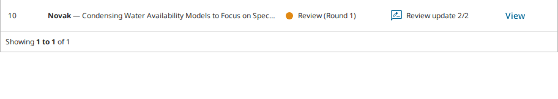
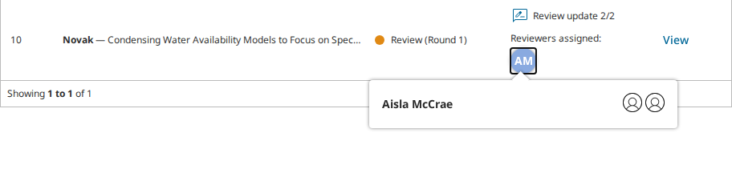
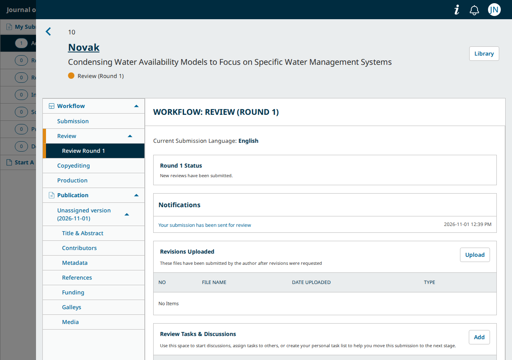

# main PRs for #13602: My Submissions and the submissions API named an open review's reviewer to the author before the editor confirmed the review; fixed in round 2

- **Severity** low
- **Effort** medium
- **Kind** intention gap
- **Affects**
  - main: none at the round-2 heads (pkp-lib `3b63f6cbb5`, ui-library `8d712dd02b`, ojs `5d8724007e`, omp `e2166dba3b`, ops `7cb7d397e0`; not merged); OJS, OMP at the round-1 heads (pkp-lib `7903807281`, ui-library `ebbb413b95`, ojs `db99dae2fb`, omp `ed7dd3bfb5`); OPS has no review; OJS `ore` the same with each round's shared commits cherry-picked
  - 3.5: none (no PR; open reviews reach the author once completed, by design there)
  - 3.4: none (the same)
  - 3.3: none (the same)
- **Introduced** `pkp/pkp-lib#13712`, `pkp/ui-library#1041` (with `pkp/ojs#6025`, `pkp/omp#2549`, `pkp/ops#1480`) for `pkp/pkp-lib#13602` · [7903807281](https://github.com/pkp/pkp-lib/pull/13712/commits/7903807281abe3825dd2d8fda9795aaeec03325e), [ebbb413b95](https://github.com/pkp/ui-library/pull/1041/commits/ebbb413b9583d379249277860e2642a49f20e786) · 2026-11-04 · Erik Hanson (ewhanson); not merged
- **Upstream** `pkp/pkp-lib#13602` (open; this report covers its requirements the PRs leave out)
- **Tracked in** ci-triage companion row `i13602` · Temporary: delete once acted on
- **Checked** 2026-11-04, round 2 at the heads in Affects; round 1 at its heads and their bases (the `main` tips; the commits in Evidence); OJS `ore` at its tip with and without each round's shared commits
- **Model** claude-opus-5-5

Update 2026-11-04: round 2. Every PR was force-pushed onto the same
bases, one commit each. pkp-lib `3b63f6cbb5` keeps round 1's policy
change and adds the API half of the proposed fix:
`AnonymizeData::reviewsToAnonymize()` now blanks an open review's
reviewer unless it has `dateConsidered`. ui-library `8d712dd02b` keeps
round 1's filter and adds the dashboard half:
`DashboardCellSubmissionActivityReviewsOpen.vue` lists
`getConfirmedReviewAssignments()` (complete or thanked, the statuses an
editor's "Mark as Complete" and "Thank Reviewer" set, both with
`dateConsidered`) instead of the completed ones. The app PRs point at
them. **Fixed**: at the round-2 heads, before the confirmation, the
author's My Submissions row has no "Reviewers assigned:" line, and the
API record of the review has an empty name and username and no id. The
same holds for the submission's other reviewer, whom the same function
covers. After "Mark as Complete" the avatar, the popover's name and the
API fields are back. The review round still behaves as at round 1. The
editor's reviewer list names the reviewer throughout. OJS `ore` with the
two round-2 commits cherry-picked (`git range-diff` all `=`) gives the
same result. Two more suite tests follow the change on the companion (U22
S4 on OJS and OMP).

## Summary

pkp-lib#13602 asks that an open review stay hidden from the author until
an editor has confirmed it ("Read Review" › "Mark as Complete"): the
reviewer's name as well as the review, "the same default visibility
behaviour of double anonymous reviews (i.e. no information/data
disclosure to the author)". The PRs do this for the workflow's review
round. Before the confirmation, the author sees no reviewers list and no
"Read Review", and the "Read Review" address refuses. After it, the
author reads the review as before. Two other places still name the
reviewer to the author as soon as the reviewer submits:

- **My Submissions**: the submission's row reads "Reviewers assigned:"
  with the reviewer's initials, and the avatar's popover gives the full
  name ("Aisla McCrae").
- **The submissions API** (`GET submissions/{id}`, and the dashboard's
  `_submissions` list): the review's record carries `reviewerFullName`,
  `reviewerUserName` and `reviewerId` for the author.

The same holds for OJS `ore` with the two shared commits cherry-picked.

## Impact

- **Lost**: the gating the issue asks for, for the reviewer's identity.
  An author learns who reviewed the submission before the editor has
  accepted the review into the record, on the dashboard they open first.
  The review text and the recommendation stay hidden on screen.
- **Who**: the authors of every submission with an open-method review,
  from the reviewer's submission until the editor's confirmation (and
  again after an editor "unconsiders" a review).
- **Way round**: none for the journal. The editor cannot hide the name
  except by confirming the review at once.

Low: nothing is lost and every task gets done; the name is one the
reviewer agreed to disclose in an open review. It would be medium if the
team treats the identity before confirmation as confidential, as the
issue's second requirement reads.

## Steps to reproduce

PKP's default test dataset, OJS `main` with the PRs, `publicknowledge`.
Submission 10, "Condensing Water Availability Models to Focus on Specific
Water Management Systems", has Aisla McCrae's review completed and not
yet confirmed.

1. As `dbarnes`, open submission 10's workflow, Review. On Aisla
   McCrae's row choose "More Actions" › "Edit", set "Review Type" to
   "Open", "OK".
2. Sign in as the author `jnovak`. On My Submissions, the row reads
   "Reviewers assigned:" with an "AM" avatar. Click it: the popover says
   "Aisla McCrae".
3. Press "View": the review round lists no reviewer (as the issue
   asks).
4. Open `index.php/publicknowledge/api/v1/submissions/10` in the same
   browser. Review 15's record has `"reviewerFullName": "Aisla McCrae"`,
   `"reviewerUserName": "amccrae"`, `"reviewerId": 9` and
   `"dateConsidered": null`.

Expected at steps 2 and 4: no avatar, no name, and the name, username and
id blank, as for an anonymous review, until the editor marks the review
complete. OMP: submission 16, Adela Gallego, author `mpower`, the same
steps and the same result.

## Cause

The PRs gate the two places the review round uses:
`ReviewAssignmentRequiredPolicy` refuses an open assignment without
`dateConsidered` (pkp-lib), and `getOpenAndCompletedReviewAssignmentsForRound`
filters on `dateConsidered` instead of `dateCompleted` (ui-library).

- My Submissions' "Reviewers assigned:" cell,
  `src/pages/dashboard/components/DashboardTable/DashboardCellSubmissionActivity/DashboardCellSubmissionActivityReviewsOpen.vue`,
  lists `getOpenReviewAssignments(getCompletedReviewAssignments(...))`:
  completed, not confirmed.
- The API's anonymisation for authors,
  `api/v1/submissions/AnonymizeData.php` `reviewsToAnonymize()`, blanks a
  review's reviewer fields only when its method is not open
  (`$reviewAssignment->getReviewMethod() !== SUBMISSION_REVIEW_METHOD_OPEN`),
  whatever `dateConsidered` says. `classes/submission/maps/Schema.php`
  `getPropertyReviewAssignments()` then returns the name, username, id
  and initials.

## Proposed fix

Round 2 does this. Not tried here before that. Two places, the same
condition as the PRs':

- pkp-lib, `AnonymizeData::reviewsToAnonymize()`: also anonymise an open
  review that has no `dateConsidered` when the caller is an author (the
  reviewer's own assignment stays excluded as now).
- ui-library, `DashboardCellSubmissionActivityReviewsOpen.vue`: list the
  open reviews that have `dateConsidered`, as the review round now does.
  With the API change alone the cell would still draw an avatar without
  initials.

Check: the steps above at the fixed heads, before and after the editor's
"Mark as Complete" (`checks/sync/pkp-lib-13712/gap.js` and `walk.js`); the
editor's own reviewer list, which reads the same API record, must keep
the names.

## Evidence

- PR heads: pkp-lib#13712 `7903807281` (ewhanson `i13602`, one commit on
  the tip `25fdc98a3e`), ui-library#1041 `ebbb413b95` (one commit on the
  tip `eb988214e9`), ojs#6025 `db99dae2fb` (on `9552aa521a`), omp#2549
  `ed7dd3bfb5` (on `828150a8fe`; moves `lib/pkp` from `1ae711024a`, which
  adds the #13690 merge, reviewed), ops#1480 `dea853fd29` (on
  `0acd73102d`); each app PR is the two pointer bumps.
- `shared/playwright/checks/sync/pkp-lib-13712/walk.js` on dataset fleet
  1, freshly loaded per run, OJS and OMP, base (the app tips) vs head.
  Before the confirmation: at the base, the reviewers list with the
  reviewer and "Read Review", and the window's address answering the
  name, the recommendation (OJS) and the shared remark. At the head: no
  reviewers list, no "Read Review", and the address answering "You do
  not have permission to access this review assignment." (OMP: "You have
  been denied access because you do not seem to be a valid reviewer for
  this monograph."). After "Read Review" › "Mark as Complete": the same
  at both refs, the window readable. At both refs and both moments the
  My Submissions row reads "Reviewers assigned: AM" (OMP "AG"), and the
  API record carries the name, username and id. No page script error.
- `gap.js` at the heads, OJS and OMP: the popover "Aisla McCrae Open" /
  "Adela Gallego Open"; the API `reviewerFullName` set,
  `dateConsidered` null; the review round without a reviewers panel.
- OJS `ore` (worktree `pkp-e2e-s1-ore`, ojs `ad3042f92f`, pkp-lib
  `f1585093d5`, ui-library `a457c27721`): both commits cherry-pick
  without conflict (`git range-diff` reads `=`); the files they touch and
  the ones named under Cause are identical to the PR bases. `walk.js`
  base vs head on a fresh dataset gives the same results as `main`.
- Round 2: `walk.js` (with the other reviewer's API read added) and
  `gap.js` at the round-2 heads on fresh datasets, OJS and OMP. Before the
  confirmation: `listReviewersAssigned` false, no avatar, `reviewerFullName`
  and `reviewerUserName` empty and `reviewerId` null for the author and for
  `agallego` / `alzacharia`. After it, all three set. Review round and
  read-review address as at round 1, no page script error. OJS `ore`
  (`walk.js`, the round-2 commits cherry-picked onto pkp-lib `f1585093d5`
  and ui-library `a457c277`): the same.
- The OJS and OMP U22 S4 tests (the "Reviewers assigned:" avatar on a
  completed open review) red at the round-2 heads unedited and pass once
  the scenario's editor confirms the review first.
- The OJS and OMP U26 S12 tests (an open review read by the author)
  red at the heads unedited, as the change intends, and pass after the
  companion's edit (the editor confirms before the author reads).
