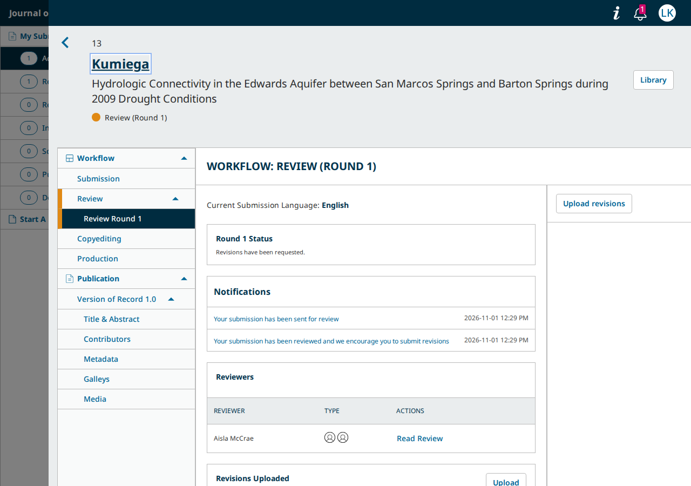
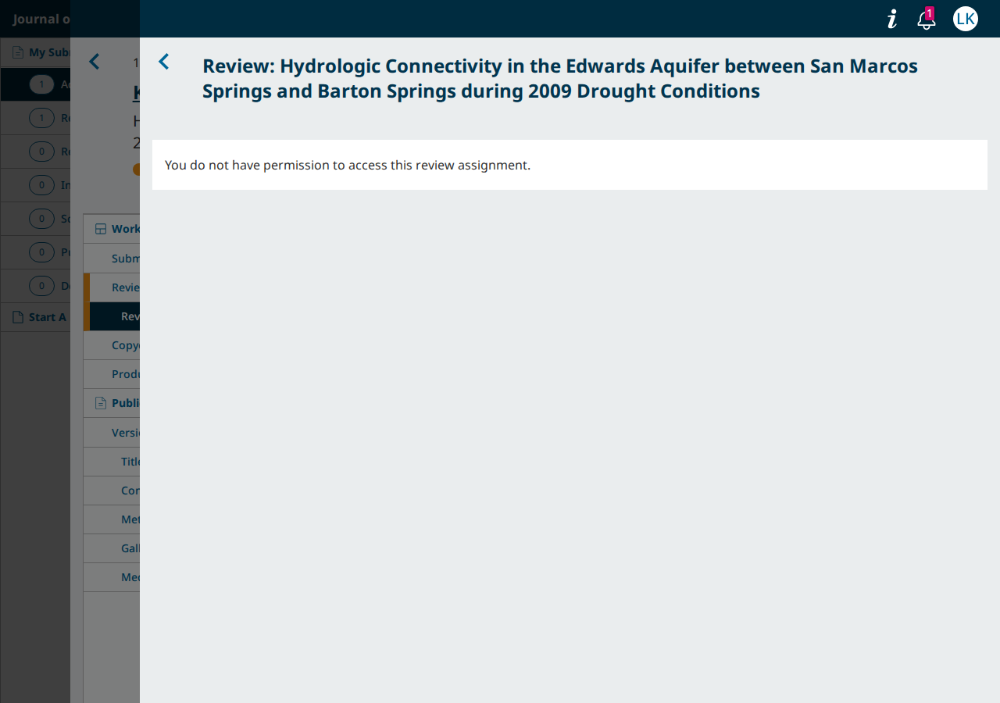
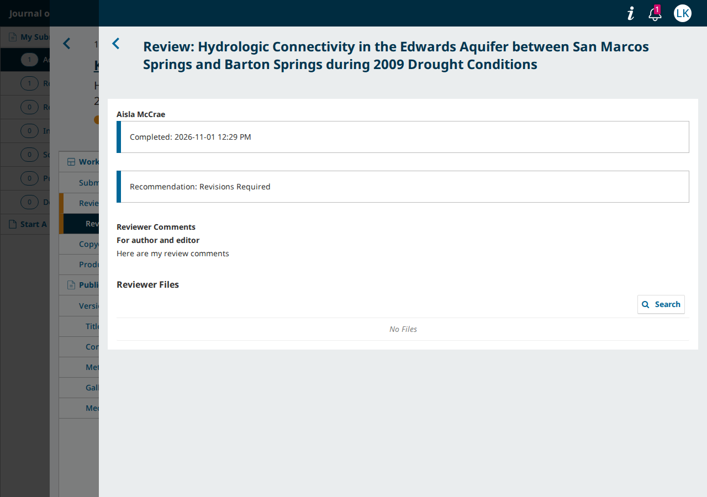

# main PRs for #13602, round 3: after an upgrade from 3.4, the author sees an open review an editor thanked there, but "Read Review" refuses it

- **Severity** medium
- **Effort** small
- **Kind** regression
- **Affects**
  - main: OJS, OMP at the round-3 heads (pkp-lib `13d982d9f4`, ui-library `255c839533`, ojs `e3f76e3205`, omp `26e1b44e38`; not merged), in a site upgraded from 3.4 or older; OPS has no review; OJS `ore` the same with the two shared commits cherry-picked (code-read)
  - 3.5: none (no PR)
  - 3.4: none (no PR)
  - 3.3: none (no PR)
- **Introduced** `pkp/pkp-lib#13712` for `pkp/pkp-lib#13602` · [13d982d9f4](https://github.com/pkp/pkp-lib/pull/13712/commits/13d982d9f440e11aa5feba14076f652def0c22f9) (round 3; the policy check came in round 1) · 2026-11-05 · Erik Hanson (ewhanson); not merged
- **Upstream** `pkp/pkp-lib#13602` (open)
- **Tracked in** ci-triage companion row `i13602` · Temporary: delete once acted on
- **Checked** 2026-11-05, the round-3 heads in Affects and their bases (the `main` tips; the commits in Evidence), each on PKP's 3.4 dataset upgraded to the checkout
- **Model** claude-opus-5-5

## Summary

pkp-lib#13602 hides an open review from the author until an editor has
confirmed it. Round 3 counts a review as confirmed once the editor
marked it complete or thanked the reviewer, unless the editor later
reverted that. On 3.4 and older, "Thank Reviewer" recorded only the
thank-you date: the "considered" date that "Mark as Complete" sets came
in 3.5, and the upgrade leaves it empty.

After the upgrade, such a review counts as confirmed in the author's
review round and in the API. The author sees the reviewer's name and
"Read Review". Pressing it opens a window that reads "You do not have
permission to access this review assignment." (OMP: "You have been
denied access because you do not seem to be a valid reviewer for this
monograph."). Before the PRs, the author read the same review.





## Impact

- **Lost**: the author cannot read an open review that the editor
  confirmed before the upgrade, while the screen offers it.
- **Who**: authors of submissions that were under way at the upgrade,
  in journals and presses that use open review, for each review the
  editor thanked on 3.4 or older.
- **Way round**: none on the author's screen. Whether the editor can
  confirm such a review again was not driven.

Medium: a core task (the author reading the reviews) fails with no way
round, but only for reviews thanked before the upgrade, a state each
site leaves behind as its old submissions close. It would be high if
the editor had no way to make these reviews readable again.

## Steps to reproduce

1. On OJS 3.4, a submission in review has an "Open" review that the
   reviewer completed and the editor thanked ("Thank Reviewer"). PKP's
   3.4 test dataset has one: submission 13, author `lkumiega`, reviewer
   Aisla McCrae, review 20 (set "Open" for this walk).
2. Upgrade the site to `main` with the round-3 PRs.
3. Sign in as the author, open the submission from My Submissions,
   "Review Round 1": "Aisla McCrae" is listed with "Read Review".
4. Press "Read Review": "You do not have permission to access this
   review assignment."

Expected: the review opens, as it does for a review the editor marked
complete after the upgrade, and as it did before the PRs.

## Cause

Round 3 adds `ReviewAssignment::isConfirmedByEditor()`: `date_considered`
or `date_acknowledged` set, and `considered` not
`REVIEW_ASSIGNMENT_UNCONSIDERED`. The API's anonymisation
(`AnonymizeData::reviewsToAnonymize()`), the new `isConfirmedByEditor`
field that the author's review round filters on (ui-library
`useSubmission.getConfirmedReviewAssignments()`), the public review
queries and the DOI checks all use it.

`ReviewAssignmentRequiredPolicy`, which guards the author's
`author-reviewer-grid/read-review` address, still refuses an open review
with an empty `getDateConsidered()`. The two agree for every review
confirmed on 3.5 or later: "Mark as Complete", "Thank Reviewer" and a
decision that notifies the reviewers all set `date_considered`.

They disagree for a review thanked on 3.4 or older. 3.4's
`ThankReviewerForm` sets only `date_acknowledged`. The 3.5 migration
`I10359_DateConsideredToReviewAssignments` adds `date_considered` with
no backfill. PKP's 3.4 datasets upgraded to the head hold exactly that
row: `considered` 0, `date_considered` null, `date_acknowledged` set
(OJS reviews 19-21, OMP 10, 11, 16, 18).

- Round 2 checked `date_considered` in all three places, so such a
  review stayed hidden from the author, list included (code-read).
- At the base no check exists, and the author reads it (walked).

## Proposed fix

Make the policy use the same test as the rest of the change:

```diff
--- a/classes/security/authorization/internal/ReviewAssignmentRequiredPolicy.php
+++ b/classes/security/authorization/internal/ReviewAssignmentRequiredPolicy.php
@@ -73,7 +73,7 @@ class ReviewAssignmentRequiredPolicy extends DataObjectRequiredPolicy
 
             if (
                 $reviewMethod === ReviewAssignment::SUBMISSION_REVIEW_METHOD_OPEN
-                && empty($reviewAssignment->getDateConsidered())
+                && !$reviewAssignment->isConfirmedByEditor()
             ) {
                 return AuthorizationPolicy::AUTHORIZATION_DENY;
             }
```

Tried at the round-3 heads on OJS and OMP. The upgraded review opens
for the author, with the reviewer's name and comments. The other walks
are unchanged: an unconfirmed open review is still refused and opens
after "Mark as Complete", and a thanked review an editor reverts is
refused again.

- **Alternatives**: backfill `date_considered` from `date_acknowledged`
  in an upgrade migration. That also repairs the old rows, but every
  check would still have to agree on one definition.
- **What goes with it**: nothing else in the PRs reads
  `date_considered` alone for this purpose. The article search's
  reviewer filter (`DatabaseEngine`, `whereNotNull('ra.date_considered')`)
  does too, but that is on `main` already and not part of the PRs
  (code-read).

Small: one line, tried, no data repair.

## Evidence

- Heads: pkp-lib `13d982d9f4`, ui-library `255c839533`, ojs
  `e3f76e3205`, omp `26e1b44e38`. Bases: ojs `2db1d0b008` (lib/pkp
  `25fdc98a3e`, ui-library `cee127f079`), omp `828150a8fe` (lib/pkp
  `1ae711024a`, ui-library `eb988214e9`).
- Data: PKP's datasets `stable-3_4_0` (pkp/datasets `c1a3abcd`), loaded
  and upgraded to 3.6.0.0 by the app's own `tools/upgrade.php`. The
  review is set "Open" in the database (`review_method` 3, the column
  the reviewer row's "Edit" › "Open" writes).
- Script `shared/playwright/checks/sync/pkp-lib-13712/legacy.js` (OJS
  submission 13 / review 20 / `lkumiega`; OMP submission 11 / review 10
  / `jlockehart`):

      PKP_E2E_DATASET_BRANCH=stable-3_4_0 npm run fleet-prep -- --feature i13602-34 --dataset 2 --reset --apps ojs,omp
      PROBE_FEATURE=i13602-34 PROBE_AGENT=<id> PROBE_RUN=<run> node bin/probe.js ojs,omp shared/playwright/checks/sync/pkp-lib-13712/legacy.js

- Head, both apps: the author's API record has the reviewer's name and
  `isConfirmedByEditor: true`, `dateConsidered: null`; the review round
  lists the reviewer with "Read Review"; the click and the address both
  answer `status: false` with the messages quoted above; no page script
  error.
- Base, both apps: the same review listed with "Read Review"; the click
  and the address answer `status: true` with the reviewer's name and
  comment.
- Try-fix (the diff above): the click and the address answer
  `status: true` with the comment ("Here are my review comments",
  OMP "I recommend that the author revise this submission.").
  `walk.js` and `revert.js` give the same results as without it.



- OJS `ore` (`ad3042f92f`, pkp-lib `f1585093d5`, ui-library
  `a457c27721`): both round-3 commits cherry-pick unchanged (`git
  range-diff` `=`), and `ore`'s `ReviewAssignmentRequiredPolicy` is the
  same, so the case reads the same there (code-read; this case was not
  driven on `ore`, which has no 3.4 dataset).
- Not driven: whether an editor can "Mark as Complete" such a review
  after the upgrade.
